# Prithvi Flood-IN: from a river-flow forecast to who goes under water

**Satellite foundation models, a flood atlas and engineering impacts for the Mahanadi delta**

CE Integrated Design Project, Department of Civil Engineering, IIT Bombay, 2026

Team: Nikhil Upadhyay (lead), Prakhar Gupta, Prabhat Kumar, Vineet Jangir, Himanshu Shete
Faculty guide: Prof. Basudev Biswal (IIT Bombay) · Industry partner: ClimMaTech Pvt. Ltd., IIT Mandi (Dr. Vivek Gupta, CTO; Siddik Barbhuiya, lead hydrologist)

## Abstract

Flood early-warning systems in India, including those of our industry partner ClimMaTech, measure and forecast the
river at points (gauges on bridges and spillways), but do not show what a forecast flow floods. We address this for
the Mahanadi delta below Naraj (3,038 km², 4.1 million people). First, we select a satellite water-mapping model
with a controlled benchmark of six geospatial foundation models (Prithvi-EO-2.0, TerraMind, DOFA, Clay, Satlas,
DeCUR) against CNN and U-Net baselines on Sen1Floods11 (92 training runs, three seeds). On a flood in India that
no model saw in training (Assam 2016), U-Net reached IoU 0.770 and the best foundation
model 0.747; fusing U-Net, CNN and the best-validated foundation model reached 0.776.
Because monsoon floods are under cloud, the operational model is a radar-only fusion of TerraMind-B and U-Net
(IoU 0.681 on 20 m radar, trained on 20 m input). Applied to 590 Sentinel-1 passes from
2017 to 2026, it gives a flood atlas of the delta. Linking the atlas to GloFAS discharge at
Naraj, each 20 m pixel receives the flow at which it starts to flood, so a discharge forecast becomes a flood map;
on years held out from fitting, this map beats flood climatology at high flows (IoU 0.20 vs
0.04). For the 25-year flood (32,997 m³/s) about 30,427 people live on
flooded land, 39 km of road is under water and 52,423 people in
41 settlements lose road access to any hospital. A learned model that adds local
rain and each pixel's flood history to the river flow maps held-out heavy-rain passes better still (IoU
0.22 against 0.15). A gradient-boosted model forecasts the Naraj flow one to three days ahead from the upstream flows and the catchment rain (Nash-Sutcliffe efficiency 0.99, 0.94 and 0.89 on monsoons it never saw, against 0.96, 0.88 and 0.79 for persistence), and a live feed turns each day's GloFAS ensemble into an impact-based warning with a CAP alert. The same pipeline mapped the Brahmani–Baitarani delta and the Brahmaputra at Majuli from every Sentinel-1 pass since 2017. Flood damage to houses and paddy comes to about ₹17 crore a year (a lower bound), and raising ten critical roads repays its cost 17 times in hospital access alone. The same scenarios are carried
through seven civil-engineering specializations: hospital and shelter access and travel delay (transportation), wall
failure depth and IRC:78 bridge scour (structural), river banks to inspect and ground saturation under houses that
stay dry (geotechnical), Bay of Bengal storms as a flood driver (ocean), work windows, earthwork for raising critical
links and a deployment schedule (construction management), and the watershed above the delta, where about half of a
flood peak comes from below Hirakud dam (water resources). An audit of all 92 training runs found no problems and
reproduces the published TerraMind scores within a point. We provide a forecast-to-bulletin tool with CAP alerts, a map
viewer and project website, and a field protocol that measures what the models cannot know (accuracy at random
points, discharge and roughness, bridge clearance, bank soils, well levels).

**Keywords:** flood mapping, Sentinel-1, geospatial foundation models, TerraMind, Prithvi, U-Net, Mahanadi, impact-based
flood warning, road network, river-bank screening

## Team and contributions

| Member | Specializations | What they built | Report | At the site |
|---|---|---|---|---|
| Nikhil Upadhyay (lead) | Water resources, Ocean | Flow-to-flood model, rain analogs, learned flow + rain model, Naraj flow forecast model, design floods and travel time, the watershed analysis, Saint-Venant PINN; storm drivers; field-visit organisation and WRD/CWC contacts | §5, §6.3–6.6, §7.6, §7.8 | Discharge, slope, Manning's n (B, C); WRD/CWC interviews |
| Vineet Jangir | Remote sensing | Benchmark of six foundation models against CNN and U-Net (92 runs), fusion, radar models retrained on 20 m input | §4, §6.1, Appendix B | Ground-truth points (A) |
| Prakhar Gupta | Remote sensing | Flood atlas from all Sentinel-1 passes, Sentinel-2 cross-check, atlases of the two other basins, map viewer | §6.1–6.2, §6.8 | Ground-truth points, GPS and photo log (A) |
| Himanshu Shete | Transportation systems, Structural | Road-network model (hospital and shelter access, travel delay, critical links), flood depth, wall and IRC:78 scour checks; integration of the impact chain, forecast-to-bulletin tool with CAP alerts, live warning feed with data plugins, flood-risk economics, training audit, gap analysis against the partner's services, project website, report and slides | §7.1–7.3, §7.9, §9.1–9.2, §9.6–9.7, Appendix A | Bridge inspections, foundation levels, road closures (D); evening data runs |
| Prabhat Kumar | Geotechnical, Construction technology and management | Bank screening, ground-saturation advisory, foundation and drawdown checks; work windows, earthwork, deployment quantities and schedule; siren and sensor siting | §7.4–7.5, §7.7, §9.3–9.4 | Bank inspection, soil samples and lab tests, well levels, site sheets (E, F, H) |

## 1. Introduction

### 1.1 The problem in the field

ClimMaTech, the project's industry partner (IIT Mandi), builds flood early-warning systems: non-contact radar
gauges on bridges and dam spillways (Pravaah, Tarang), edge-AI camera nodes (Doordrishti), solar sirens
(Rakshak), a control-room web application and the Aagah mobile app. Their architecture lists a "River View"
layer, a map-based view of river levels and flood risk. Every product measures or forecasts the river **at a
point**: the level and flow at a gauge, 30 minutes to 48 hours ahead. None of them shows what that flow means on
the ground: which land, villages, roads, bridges and embankments go under water. Their own case study of the
26 August 2026 Nepal–China flood compares a 1-D Saint-Venant model with flood widths measured on Sentinel-2
images, which is exactly the link between satellite water maps and hydraulics that this project builds.

The Mahanadi delta below Naraj (Cuttack, Kendrapara, Jagatsinghpur; about 4.1 million people in our 3,038 km²
study box) is the most flood-exposed reach of the Mahanadi basin, where Prof. Basudev Biswal's long-running basin work,
the Hirakud–Naraj flood operations of the Odisha Water Resources Department and the Central Water Commission's
gauges all meet. The IDP review of 14 October asked us to connect one fine-tuned foundation model to such a
real project, to go to the site with a purpose, and to bring in the other civil-engineering disciplines that a
river project involves.

**Refined problem statement.** *For the Mahanadi delta, turn a river-flow forecast at Naraj into a map of what
floods and whom it affects, using a satellite foundation model selected by a fair benchmark, and use that map to
plan where warnings and sensors should go.* Concretely we

1. select a satellite water-mapping model by benchmarking six geospatial foundation models against CNN and U-Net
   baselines, including on a flood in India that the models never saw (§4);
2. run it on every Sentinel-1 radar pass over the delta from 2017 to 2026 (monsoon and dry season) to build a
   flood atlas, and check it against Sentinel-2 images taken within a day (§6);
3. link the atlas to river discharge at Naraj, so that a discharge forecast becomes an inundation map, and test
   that link on years it was not fitted on (§6);
4. translate inundation into what it means for each of the department's specializations: people and roads
   (transportation), walls and bridges (structural), river banks and foundations (geotechnical), storms (ocean),
   when and at what cost to build (construction management) and the watershed above the delta (water resources) (§7);
5. plan siren and river-sensor sites for a ClimMaTech-type deployment (§9);
6. forecast the Naraj flow days ahead, run the warning on live data, put the flood risk in rupees and repeat the
   method on two more basins (§6.7–6.8, §7.9, §9.7); and
7. check and calibrate all of this with measurements and interviews at the site (§8).

### 1.2 Stakeholders

| Stakeholder | Role in the problem | What they need from this work | What we need from them |
|---|---|---|---|
| ClimMaTech (Dr. Vivek Gupta, CTO; Siddik Barbhuiya, lead hydrologist) | Industry partner; sensors, sirens, forecasts | A flood-extent layer and village list per forecast; sensor and siren siting | Product constraints (siren range, data formats), site-survey practice |
| Prof. Basudev Biswal's Mahanadi basin project (IIT Bombay) | The sanctioned real project | Inundation maps and impacts for the delta | Site access, introductions to engineers |
| Odisha Water Resources Dept., CWC Mahanadi division | Embankments, Naraj/Mundali barrages, gauges | Which banks and roads fail at which flow | Observed discharge, embankment inventory, breach history |
| OSDMA, district administrations (Cuttack, Kendrapara, Jagatsinghpur) | Warnings, evacuation, shelters | Villages to warn per forecast; cut-off roads | Evacuation records, shelter list |
| Villages and farmers in the delta | Flooded every few years | Earlier, local warnings | What actually flooded, when and how deep |

### 1.3 Where the project stood at mid-term

At mid-term (5 October 2026) the team had fine-tuned the published Prithvi-EO-2.0 Sen1Floods11
checkpoint on 3,584 Indian chips built from NDEM flood maps. Test IoU on 16 unseen Indian events
rose from 0.337 to 0.375. The review of that work (mid-term meeting) raised five problems that this
second half addresses directly:

1. **The absolute scores were far below the benchmark** (IoU ≈ 0.68–0.71 for Sen1Floods11 models),
   which pointed to problems in how the Indian chips and masks were built rather than in the model.
2. **There was no from-scratch baseline**, so the value of the foundation model was not isolated.
3. **Only optical data were used**, although monsoon floods happen under cloud.
4. **One training run per model**, so run-to-run noise was unknown. (The mentor notebook itself
   shows ±0.02 IoU for the same U-Net, same data, same seed.)
5. The mentors' new plan (7 October): every team member takes one foundation model, all models are
   trained on a common dataset, compared zero-shot and fine-tuned, and then fused into one model.

The NDEM-based Indian dataset lives on a team member's Google Drive and was not available on the lab
server used for this phase. All new experiments therefore use **Sen1Floods11**, the dataset of the
mentor notebook, with two protocols designed to answer the Indian question honestly (Section 2.2).

### 1.4 Objectives of this phase

| No. | Objective | Discipline | Answered in |
|---|---|---|---|
| F1 | Compare six foundation-model families against from-scratch and no-training baselines under one identical recipe | AI / remote sensing | §4.1 |
| F2 | Measure performance on a flood event the models have **never seen** in India | AI / remote sensing | §4.2 |
| F3 | Separate what pre-training gives for free (frozen encoder) from what fine-tuning adds | AI / remote sensing | §4.3 |
| F4 | Fuse the models ("fuse layer") and test whether the fusion beats the best single model | AI / remote sensing | §4.4 |
| F5 | Decide whether radar, optical or both are needed (monsoon cloud) | remote sensing | §4.5 |
| F6 | Calibrate thresholds; errors by event and by permanent vs flood water; label efficiency | AI / remote sensing | §4.6–4.7 |
| F7 | PINN track: verify, reproduce, complete the residual exercise, retrain | hydraulics | §5 |
| F8 | Flood atlas of the Mahanadi delta 2017–2026 with an independent optical check | remote sensing, hydrology | §6.1–6.2 |
| F9 | Discharge-to-inundation model at Naraj, tested on held-out years; design floods | hydrology | §6.3–6.5 |
| F10 | Exposure; hospital and shelter access, everyday travel delay and critical links | transportation systems | §7.1–7.2 |
| F11 | Flood depth, masonry-wall screening, bridge scour (IRC:78) and clearance (IRC:5) | structural | §7.3 |
| F12 | River-bank screening; ground saturation under houses that stay dry; foundation and slope checks | geotechnical | §7.4–7.5 |
| F13 | Bay of Bengal storms as a flood driver | ocean | §7.6 |
| F14 | Work windows, earthwork for raising critical links, deployment quantities and schedule | construction technology & management | §7.7 |
| F15 | Field visit: measure, ask, and feed the results back into the models | all | §8 |
| F16 | Siren and river-sensor siting; forecast-to-bulletin tool; integration with the ClimMaTech platform | construction planning | §9 |
| F17 | A learned model that adds local rain and flood history to the river flow | hydrology, AI | §6.6 |
| F18 | The watershed above the delta: how much of a flood peak comes from Hirakud dam and how much from the tributaries below it | water resources | §7.8 |
| F19 | Check every training run, reproduce published scores, retrain the radar models at the atlas resolution | AI / remote sensing | Appendices A–B |
| F20 | Read the partner's services and list, with evidence, what this project adds | all | §9.6 |
| F21 | Forecast the Naraj flow one to three days ahead from upstream flows and catchment rain, tested on unseen monsoons | water resources, AI | §6.7 |
| F22 | Repeat the atlas and its link to river flow on two more basins | remote sensing, hydrology | §6.8 |
| F23 | Flood risk in rupees and person-days; benefit–cost of raising critical roads; what dam operation saves | structural, transportation, construction management, water resources | §7.9, C.9 |
| F24 | A live warning service: today's forecasts and official alerts in, an impact-based warning, CAP alert and feed out | all | §9.7 |

## 2. Data

### 2.1 Sen1Floods11 (hand-labelled subset, v1.1)

446 chips of 512 × 512 pixels (~5 km × 5 km at 10 m) from 11 flood events. Each chip has
Sentinel-2 L1C (13 bands, top-of-atmosphere reflectance × 10⁴), Sentinel-1 GRD (VV, VH, σ⁰ in dB),
a hand label (1 water, 0 dry, −1 unknown), and the JRC permanent-water layer. The archive downloaded
on the lab server matches the published checksum (SHA-256 `d836b0c9…640a4f`).

The labels mark **all surface water during the flood**, including normal rivers and lakes
(96.4 % of JRC permanent-water pixels are labelled water). Section 4.6 therefore also scores every
model on non-permanent water only, which is closer to "flood".

Our audit of the cache (`results/audit.json`):

| Event | Chips | Water share of labelled pixels | Unknown share | Permanent share of water |
|---|---|---|---|---|
| India (Assam, 12 Aug 2016) | 68 | 12.4 % | 16.0 % | 19.5 % |
| USA | 69 | 4.6 % | 2.4 % | 33.0 % |
| Paraguay | 67 | 8.4 % | 5.0 % | 33.5 % |
| Ghana | 53 | 6.3 % | 33.8 % | 12.6 % |
| Sri Lanka | 42 | 11.8 % | 9.5 % | 69.2 % |
| Mekong | 30 | 24.1 % | 9.3 % | 28.6 % |
| Spain | 30 | 13.2 % | 1.7 % | 39.5 % |
| Pakistan | 28 | 7.5 % | 26.7 % | 18.9 % |
| Somalia | 26 | 6.5 % | 21.1 % | 0.0 % |
| Nigeria | 18 | 23.5 % | 14.3 % | 8.4 % |
| Bolivia (held-out) | 15 | 15.9 % | 27.1 % | 6.6 % |

Missing measurements: 2.2 % of radar pixels are NaN and 2.1 % of optical pixels are 0.

### 2.2 Two evaluation protocols

| Protocol | Train | Validation | Test | What it measures |
|---|---|---|---|---|
| **Official** | 252 chips (10 events incl. 40 India) | 89 | 90 (all 10 events) | Comparable with published numbers; test events were also seen in training |
| **Leave-India-out (LIO)** | 212 chips (9 events, no India) | 75 (no India) | **all 68 India chips** | A flood the model has never seen, in India: Assam / Brahmaputra, Aug 2016 |

Both protocols also report the official **Bolivia** hold-out (15 chips, an event never in any training set).
The LIO protocol follows the caution in our data kit: the official split puts the single Indian event
in train, validation and test, so its "India score" is not an unseen-event score.

### 2.3 Mahanadi delta: satellite archive and context layers (no flood labels)

The study box is the central delta around Cuttack–Kendrapara (85.80–86.45 °E, 20.25–20.65 °N, 3,038 km²; one
UTM 45N grid at 10 m for single events and 20 m for the atlas). All sources are open and need no login.

| Layer | Source | Use |
|---|---|---|
| Sentinel-1 RTC γ⁰ (VV, VH), every pass in Feb–Mar and Jun–Nov, 2017 – Oct 2026, three tracks (descending 48 and 121, ascending 85), Sentinel-1A/B/D | Microsoft Planetary Computer, `sentinel-1-rtc` | flood atlas (§6) |
| Sentinel-2 L2A (B03, B11, scene classification) within ±1 day of a radar pass | Planetary Computer, `sentinel-2-l2a` | independent optical check (§6.2) |
| JRC Global Surface Water occurrence 1984–2021 | Planetary Computer, `jrc-gsw` | normal rivers and lakes |
| River discharge, daily, Naraj / Tikarpara / below Hirakud, 1997–2026 (the API has no earlier values at these cells) | GloFAS v4 reanalysis via the Open-Meteo flood API | discharge-to-inundation model, design floods |
| Rainfall, daily, mean of 6 points over the delta, 2016–2026 | ERA5 via the Open-Meteo archive API | second flood driver (§6.4) |
| Population 2020 (3″ grid) | JRC GHSL GHS-POP R2023A | people exposed, settlements |
| Building footprints | Microsoft Global ML Building Footprints (incomplete here: ~120 k) | mapped buildings exposed |
| Land cover 2021 | ESA WorldCover (Planetary Computer) | farmland, built-up |
| Elevation | Copernicus GLO-30 DEM (Planetary Computer) | context |
| Soil sand / silt / clay, 0–30 cm | ISRIC SoilGrids 2.0 (250 m) | bank screening (§7.4) |
| Roads (with node ids), railways, waterways | OpenStreetMap via Overpass | network analysis, bridges |
| Places, hospitals and clinics, schools, embankments, shelters | OpenStreetMap, Geofabrik eastern-India extract (the Overpass servers were overloaded) | destinations, names |
| Cyclone and depression tracks, North Indian Ocean, 1980–2025 | IBTrACS v4 (NOAA NCEI) | storm drivers (§7.6), work windows (§7.7) |
| Basin areas: Hirakud catchment about 83,400 km², whole Mahanadi basin about 141,600 km² | published figures (sources differ by about 2 %) | watershed view (§7.8) |
| Rainfall, daily, mean of 8 points over the catchment between Hirakud and Naraj, 1984–2026 | ERA5 via the Open-Meteo archive API | flow forecast (§6.7) |
| River-flow forecast: GloFAS v4 control run and 50 ensemble members, 30 days | Open-Meteo flood API | live warnings (§9.7) |
| Rain forecast, ECMWF IFS 0.25°, 16 days | Open-Meteo forecast API | live warnings (§9.7) |
| Official alerts (IMD, CWC, SDMA) as CAP | NDMA SACHET feed of the state | live warnings (§9.7) |
| CWC stations above warning level | CWC flood-forecasting portal | live warnings (§9.7) |
| Depth–damage curve for houses in Asia; rural housing assistance; Odisha rice yield; paddy support price | JRC (Huizinga et al. 2017); PMAY-G (₹1.20 lakh); RBI Handbook 2023-24 (2,081 kg/ha); MSP 2025-26 (₹2,369 a quintal) | flood risk in rupees (§7.9) |
| The same layers for the Brahmani–Baitarani delta (86.20–86.90 °E, 20.58–21.08 °N) and the Brahmaputra around Majuli (93.90–94.60 °E, 26.70–27.30 °N) | as above; JRC occurrence for both boxes | other basins (§6.8) |

Optical images on the large flood dates were 61–95 % cloud over the box, so the atlas uses radar only.

### 2.4 Software, compute and data volume

| Item | What was used |
|---|---|
| Deep learning | PyTorch with TerraTorch (IBM) for the foundation-model backbones; a common decoder and training loop in `floodfm/` |
| Geospatial | rasterio, GDAL, pyproj, geopandas, pyogrio, scipy (Dijkstra on the road graph, image morphology), pystac-client for the Planetary Computer catalogue |
| Statistics and learning on tables | scikit-learn (logistic-regression fusion layer, gradient-boosted flood model, ROC AUC), pandas, numpy |
| Maps and documents | matplotlib, Leaflet 1.9.4 (map viewer), pandoc / python-docx / python-pptx (report and slides) |
| Compute | IIT Bombay lab server: 2 GPUs, 32 CPU cores, 62 GB memory; the benchmark cache sat in RAM because the data disks are slow |
| Data volume | Sen1Floods11 hand-labelled set 446 chips; Mahanadi radar archive 590 passes at 20 m (about 11 GB); atlas probability maps about 1.7 GB; each further basin a similar archive |
| Run times | one benchmark run 2–6 minutes for the U-Net and 5–31 minutes for a foundation model (the range follows the shared server's load); one radar pass mapped in about 5 s on one GPU; atlas build about 26 minutes; impact chain about 5 minutes; learned flood model about 27 minutes on 28 cores; flow–impact sweep about 9 s; flow-forecast models about 15 s on 32 cores; one live run about 15 s per basin |

## 3. Methods

### 3.1 One pipeline for every model

All models read chips through the same code (`floodfm/`), so differences in scores come from the
models:

- **Inputs**: 13 Sentinel-2 bands + VV, VH. Prithvi uses the six HLS bands it was pre-trained on
  (B02, B03, B04, B8A, B11, B12); Satlas and DeCUR are optical-only by design; TerraMind, DOFA and Clay
  receive optical and radar.
- **Normalisation**: each band is standardised with the model's own pre-training statistics where
  they are published (TerraMind, Prithvi), otherwise with statistics of the training split. Missing
  pixels are replaced by the band mean before standardising, so they become exactly 0. (The mentor
  notebook filled missing VH with the VV mean, which becomes 1.31 after standardising.)
- **Training recipe** (identical for all): full 512 × 512 chips; random rotations/flips (D4);
  loss = cross-entropy + soft Dice on the water class with unknown pixels ignored; AdamW with 2-epoch
  warm-up and cosine decay; 40 epochs; batch 8; bf16. Learning rates: 10⁻³ for from-scratch models;
  5 × 10⁻⁵ for pre-trained encoders and 3 × 10⁻⁴ for the new decoder.
- **Model selection**: the epoch with the best validation water IoU. Test chips are used once, after
  training.
- **Seeds**: every fine-tuned model is trained with seeds 0, 1, 2 under both protocols; tables give
  mean ± standard deviation.
- **Metric**: water IoU (TP / (TP + FP + FN)) over labelled pixels, pooled over all test chips;
  also F1, precision, recall, mean per-chip IoU and per-event IoU.

### 3.2 Models

| Group | Model | Parameters | Pre-training | Inputs used |
|---|---|---|---|---|
| No training | Otsu threshold on VH | 0 | — | S1 VH |
| No training | NDWI > 0, MNDWI > 0 | 0 | — | S2 green/NIR, green/SWIR1 |
| No training | Prithvi-EO-2.0-300M-TL-Sen1Floods11 (published) | 324 M | HLS MAE + Sen1Floods11 fine-tune by IBM/NASA | 6 S2 bands |
| From scratch | Simple CNN (3 conv) | 0.02 M | none | 15 bands |
| From scratch | U-Net (4 levels, 32 base channels) | 7.8 M | none | 15 bands |
| Foundation | Prithvi-EO-2.0-300M (ViT-L) | 324 M | masked autoencoder on global HLS | 6 S2 bands |
| Foundation | TerraMind-v1-base (ViT-B) | 103 M | multimodal generative, S1+S2+DEM+LULC… | 13 S2 + 2 S1 |
| Foundation | DOFA-base (ViT-B) | 128 M | wavelength-conditioned MAE, optical + SAR | 13 S2 + 2 S1 |
| Foundation | Clay-v1-base (ViT-B) | 108 M | wavelength-aware MAE, multi-sensor | 13 S2 + 2 S1 |
| Foundation | Satlas Swin-v2-B | 93 M | SatlasPretrain, Sentinel-2 multispectral | 13 S2 |
| Foundation | SSL4EO-S12 DeCUR ResNet-50 | 35 M | contrastive (DeCUR), Sentinel-2 | 13 S2 |

The four ViT encoders feed four of their layers through a learned feature pyramid into the same
UNet-style decoder (channels 512-256-128-64); the hierarchical encoders (Swin, ResNet) feed their four
stages into the same decoder type. Every model outputs two logits per pixel.

**Frozen vs fine-tuned.** "Zero-shot" in the strict sense is impossible for Prithvi, DOFA, Clay,
Satlas and DeCUR: they are encoders and output features, not water masks. We therefore report two
modes: **frozen encoder** (only the decoder is trained — what the pre-trained features already know)
and **full fine-tune**. The published Prithvi flood checkpoint is the one true zero-shot model.

### 3.3 Fusion ("fuse layer")

Fusion combines models of the same seed and is fitted on **validation** predictions only. Three member
sets are used: the six fine-tuned foundation models; all eight trained models (the six plus CNN and U-Net); and
the three models with the best validation IoU ("top-3"). Variants:

- **Mean**: equal-weight average of the water probabilities.
- **Validation-weighted**: average weighted by each member's validation IoU.
- **Learned layer**: logistic regression on the members' logits (equivalent to a learned 1 × 1
  convolution over the stacked predictions), fitted on 400,000 validation pixels.

Merging the weights of different architectures into one network is not possible (their layers do not
correspond), so fusion is done at the prediction level, as discussed in the 7 October team call.

### 3.4 Threshold calibration and error analysis

The decision threshold on water probability is swept from 0.10 to 0.90 on the validation set; the best
threshold is then applied once to the test set. For the LIO protocol, validation contains no Indian
chips, so this is an honest test of whether a threshold transfers to a new region.

### 3.5 Flood atlas and discharge-to-inundation model (Mahanadi delta)

Code: `mahanadi/atlas_pull.py`, `atlas_infer.py`, `atlas_build.py`, `s2_crosscheck.py`.

1. **Every radar pass.** All Sentinel-1 RTC passes over the box in February–March (dry season) and June–November
   (monsoon) of 2017–2026, all slices of a pass mosaicked, on one 20 m grid. The 20 m data are the COG overviews,
   which are exact 2 × 2 averages of the 10 m power (checked against a full-resolution read); they cut the
   download four-fold, which mattered because the lab server's connection to the archive ran at 4–8 MB/s.
2. **Production model.** The mean water probability of the two radar-only models of §4 (TerraMind-B and U-Net,
   official split), each run at 10 m on the up-sampled pass with overlapping 512 × 512 windows, averaged back to
   20 m. Trained at 10 m and fed with 20 m data this way, the pair scores 0.640 on the official Sen1Floods11 test
   (0.646 at the validation threshold 0.30; native 10 m: 0.664). Retrained with the radar degraded to 20 m exactly as
   the archive's overview is made, the same pair scores 0.681 at its validation threshold 0.45, better on all three
   seeds (Appendix B); the atlas was rebuilt with this pair. RTC γ⁰ is shifted to σ⁰ by −0.97 dB.
3. **Normal water** of each year = water in at least half of that year's February–March passes, or JRC
   occurrence ≥ 50 %. **Flood** on a monsoon pass = water and not normal water of that year. Flood frequency =
   flooded passes / valid passes per pixel.
4. **Discharge.** GloFAS v4 daily discharge at Naraj (Open-Meteo). The predictor (same-day flow, previous-day
   flow, or the peak of the last 3, 5 or 7 days) is chosen by its Spearman correlation with the flooded fraction
   of each pass, because floodplains drain slowly and the map follows the recent peak.
5. **Trigger discharge per pixel.** For each 20 m pixel, the threshold θ that best separates its wet and dry
   monsoon observations under the rule "flooded when the predictor ≥ θ" (ties go to the lower θ, i.e. earlier
   warning). A forecast flow Q then gives the map {θ ≤ Q}. A per-pixel AUC of discharge between wet and dry
   observations separates **river-driven** flooding (AUC near 1) from water that comes regardless of river flow
   (AUC near 0.5: rain water-logging, paddy).
6. **Test on unseen years.** For each year, the maps are fitted on the other years and the held-out year's passes
   are predicted, then compared with the observed flood map, per pixel (IoU, precision, recall) and per settlement
   (flagged when ≥ 10 % of its people are on flooded land; probability of detection POD, false-alarm ratio FAR,
   critical success index CSI). Methods: the trigger map (flow only); **analog maps** — land flooded on at least
   half of the 7 training passes most similar in flow, or in flow and local rain (ERA5 daily rain over the delta,
   window chosen like the flow predictor); and flood climatology (flooded when the pixel's frequency in the other
   years ≥ 50 %).
7. **Design floods.** Gumbel distribution (method of moments) fitted to GloFAS annual maxima at Naraj
   (1997–2025, 29 years); maps for 2- to 100-year flows. Above the largest flow in the radar record the map is a lower
   bound.
8. **Independent optical check.** Sentinel-2 L2A within ±1 day of a radar pass, clear pixels only (scene classes
   vegetation, bare, water), water = MNDWI > 0; agreement with the radar atlas on the same pixels.
9. **Learned flow + rain + history model.** A gradient-boosted classifier (scikit-learn HistGradientBoosting) per
   pixel and pass, with the flow and 7-day rain of the pass, its month and radar track, and the pixel's training-year
   trigger flow, flood frequencies, height above and distance to the river bed as inputs; the physical direction of
   each input is imposed. Tested leave-one-year-out against the trigger map and climatology on the same passes (§6.6).
10. **Flow forecast.** One gradient-boosted regression per lead time (1–3 days) of the change in the Naraj flow, from
   the flows at Naraj, Tikarpara and below Hirakud, ERA5 catchment rain and the season; trained 1997–2015, tested on
   the monsoons of 2016–2026 against persistence and linear routing (§6.7).
11. **Flow–impact tables.** The trigger map swept once over flows from 500 m³/s to the 100-year flow, every 250 m³/s:
   flooded land, people, villages with 10 % of their people on flooded land, health facilities and schools near water,
   roads cut (≥ 20 m of an edge under water) and people cut off from every hospital, and per village, road and facility
   the flow at which it is hit (`mahanadi/impact_curve.py`; it reproduces the design-flood numbers of §7 exactly). The
   live warnings (§9.7) and the risk estimate (§7.9) read these tables.

### 3.6 Engineering impact analyses

All on the same 20 m grid and for the same scenarios (2- to 100-year floods, the largest flood seen, land flooded in
at least 10 % of monsoon passes); code in `mahanadi/impact_*.py`, `ocean_cyclones.py`, `cm_plan.py` and
`watershed_share.py`. Each specialization gets one question and one method:

| Specialization | Method in one line |
|---|---|
| Exposure (all) | GHSL population, settlements, WorldCover farmland, OpenStreetMap roads, bridges, hospitals and schools on flooded land |
| Transportation systems | Road graph from OpenStreetMap; flooded sections cut; shortest paths to hospitals, towns and dry schools; critical links |
| Structural | Flood depth from the elevation at the flood edge; bending check of brick walls; IRC:78 (Lacey) scour at major bridges |
| Geotechnical | Bank cells ranked by water behind the bank, soil and people; a 200 m ground-saturation advisory with bearing and settlement checks |
| Ocean | IBTrACS storm tracks matched to the radar floods; each large flood labelled by its drivers |
| Construction technology and management | Monthly flood and storm climatology for work windows; earthwork for raising critical links; deployment quantities and schedule |
| Water resources and the watershed | GloFAS flows below Hirakud, at Tikarpara and at Naraj: travel time, design floods and the share of a flood peak from each part of the basin |
| Siting (deployment) | Sirens by greedy maximal coverage of exposed people at 1.0 / 1.5 / 2.0 km; one river gauge per distributary on the bridge nearest Naraj with dry approaches |
| Risk and economics (structural, transportation, construction management) | Depth × JRC depth–damage curve for houses; flooded paddy at the support price; expected annual damage; 29 years of daily flows through the flow–impact table; benefit–cost of raising the critical links |

Chapter 7 gives the results briefly; Appendix C has the formulas, parameters and full tables.

### 3.7 Everything that was trained

| Training | Runs | What it answers | Results |
|---|---|---|---|
| Six foundation models fully fine-tuned, 2 protocols × 3 seeds | 36 | Which pre-trained model maps flood water best | §4.1 |
| CNN and U-Net from scratch, 2 protocols × 3 seeds | 12 | Do foundation models beat small task-specific networks | §4.1 |
| Six foundation models with frozen encoders, 2 protocols, seed 0 | 12 | How much the pre-trained features already know | §4.3 |
| U-Net and TerraMind with radar only or optical only, leave-India-out, 3 seeds | 12 | Radar against optical | §4.5 |
| U-Net and TerraMind with radar only, official split, seed 0 | 2 | The models that map the monsoon (the atlas pair) | §4.5, §6.1 |
| Prithvi, TerraMind and U-Net with 10, 25 and 50 % of the labels, 2 seeds | 18 | Do foundation models need fewer labels | §4.7 |
| **Benchmark total** (all re-checked, Appendix A) | **92** | | |
| Fusion layers (logistic regression on validation predictions) | one per seed and protocol | Does combining models help | §4.4 |
| Radar pair retrained on 20 m input (seed 0), and seeds 1–2 of the pair at 10 m and at 20 m | 10 | The input resolution of the atlas, and its spread over seeds | Appendix B |
| Naraj flow forecast: one model per lead time (1, 2, 3 days), without and with the rain of the coming days | 6 | How far ahead the flow can be known | §6.7 |
| Learned flow + rain + history flood model: 10 held-out years and a final model, without and with physical constraints | 22 | Can flow, rain and flood history together map a pass better than flow alone | §6.6 |
| PINN for the Saint-Venant equations, case 3 retrained (Adam + L-BFGS-B, and Adam only) | 2 | Does the mentor's physics-informed network reproduce and transfer | §5 |
| Inference: every Sentinel-1 pass through both radar models | 1,180 maps | The flood atlas | §6.1 |
| Inference: every pass of the two other basins through the same pair | two maps per pass | Their atlases | §6.8 |

## 4. Results: which model maps Indian flood water best?

All numbers in this section come from `results/analysis/summary.json` (92 training runs, three seeds per
fine-tuned model) and are reproduced by `scripts/analyze.py` and `scripts/make_tables.py`.

### 4.1 Overall ranking

**Table A. Unseen Indian flood (leave-India-out; test = 68 Assam chips).** Water IoU and companions on test; mean ± sd over seeds where n > 1. Calibrated = threshold chosen on validation. Non-perm. = IoU on pixels that are not JRC permanent water. Bolivia = official hold-out event (never trained on).

| Method | Group | n | Test IoU | F1 | Precision | Recall | Calibrated IoU (thr) | Non-perm. IoU | Bolivia IoU | Params (M) | Train (min) |
|---|---|---|---|---|---|---|---|---|---|---|---|
| Otsu (VH radar) | no training | 1 | **0.243** | 0.391 | 0.256 | 0.821 | 0.243 (0.10) | 0.199 | 0.403 | – | – |
| MNDWI > 0 | no training | 1 | **0.506** | 0.672 | 0.521 | 0.945 | 0.602 (0.55) | 0.450 | 0.556 | – | – |
| NDWI > 0 | no training | 1 | **0.647** | 0.786 | 0.868 | 0.718 | 0.672 (0.45) | 0.578 | 0.832 | – | – |
| Prithvi published ckpt | no training | 1 | **0.738** | 0.849 | 0.887 | 0.815 | 0.740 (0.45) | 0.685 | 0.668 | – | – |
| Simple CNN | from scratch | 3 | **0.766 ± 0.005** | 0.868 ± 0.003 | 0.936 ± 0.004 | 0.809 ± 0.007 | 0.766 (0.50) | 0.716 ± 0.006 | 0.779 ± 0.006 | – | 2.9 |
| U-Net | from scratch | 3 | **0.770 ± 0.006** | 0.870 ± 0.004 | 0.915 ± 0.015 | 0.829 ± 0.007 | 0.772 (0.47) | 0.722 ± 0.006 | 0.797 ± 0.003 | 7.8 | 3.1 |
| Prithvi-EO-2.0-300M | foundation model | 3 | **0.747 ± 0.006** | 0.855 ± 0.004 | 0.875 ± 0.025 | 0.837 ± 0.020 | 0.747 (0.58) | 0.697 ± 0.007 | 0.809 ± 0.004 | 324.2 | 15.1 |
| TerraMind-B | foundation model | 3 | **0.746 ± 0.014** | 0.854 ± 0.009 | 0.889 ± 0.004 | 0.822 ± 0.019 | 0.746 (0.50) | 0.695 ± 0.017 | 0.793 ± 0.019 | 103.4 | 11.8 |
| DOFA-B | foundation model | 3 | **0.717 ± 0.002** | 0.835 ± 0.001 | 0.877 ± 0.009 | 0.797 ± 0.010 | 0.717 (0.50) | 0.660 ± 0.003 | 0.797 ± 0.007 | 127.5 | 8.8 |
| Clay-v1-B | foundation model | 3 | **0.666 ± 0.012** | 0.800 ± 0.008 | 0.839 ± 0.034 | 0.765 ± 0.015 | 0.664 (0.33) | 0.602 ± 0.012 | 0.755 ± 0.017 | 107.6 | 10.5 |
| Satlas Swin-B | foundation model | 3 | **0.719 ± 0.012** | 0.836 ± 0.008 | 0.917 ± 0.009 | 0.768 ± 0.019 | 0.713 (0.57) | 0.660 ± 0.014 | 0.778 ± 0.013 | 93.0 | 9.1 |
| DeCUR ResNet-50 | foundation model | 3 | **0.714 ± 0.003** | 0.833 ± 0.002 | 0.889 ± 0.014 | 0.784 ± 0.014 | 0.706 (0.60) | 0.656 ± 0.005 | 0.778 ± 0.004 | 34.6 | 6.6 |
| Fusion 6 FMs: mean | fusion | 3 | **0.739 ± 0.004** | 0.850 ± 0.003 | 0.906 ± 0.005 | 0.800 ± 0.008 | 0.739 (0.50) | 0.685 ± 0.005 | 0.818 ± 0.004 | – | – |
| Fusion 6 FMs: val-weighted | fusion | 3 | **0.739 ± 0.004** | 0.850 ± 0.003 | 0.906 ± 0.005 | 0.801 ± 0.009 | 0.739 (0.50) | 0.685 ± 0.005 | 0.818 ± 0.004 | – | – |
| Fusion 6 FMs: learned layer | fusion | 3 | **0.743 ± 0.007** | 0.852 ± 0.005 | 0.917 ± 0.010 | 0.796 ± 0.015 | 0.749 (0.40) | 0.689 ± 0.010 | 0.805 ± 0.004 | – | – |
| Fusion all 8: mean | fusion | 3 | **0.752 ± 0.003** | 0.859 ± 0.002 | 0.921 ± 0.005 | 0.805 ± 0.006 | 0.752 (0.50) | 0.700 ± 0.004 | 0.817 ± 0.004 | – | – |
| Fusion all 8: learned layer | fusion | 3 | **0.774 ± 0.004** | 0.873 ± 0.002 | 0.928 ± 0.010 | 0.824 ± 0.012 | 0.778 (0.45) | 0.727 ± 0.005 | 0.804 ± 0.006 | – | – |
| Fusion top-3 (val): mean | fusion | 3 | **0.776 ± 0.003** | 0.874 ± 0.002 | 0.929 ± 0.007 | 0.825 ± 0.006 | 0.779 (0.47) | 0.728 ± 0.004 | 0.801 ± 0.006 | – | – |

**Table B. Official Sen1Floods11 split (test = 90 chips, 10 events).** Water IoU and companions on test; mean ± sd over seeds where n > 1. Calibrated = threshold chosen on validation. Non-perm. = IoU on pixels that are not JRC permanent water. Bolivia = official hold-out event (never trained on).

| Method | Group | n | Test IoU | F1 | Precision | Recall | Calibrated IoU (thr) | Non-perm. IoU | Bolivia IoU | Params (M) | Train (min) |
|---|---|---|---|---|---|---|---|---|---|---|---|
| Otsu (VH radar) | no training | 1 | **0.230** | 0.374 | 0.253 | 0.714 | 0.230 (0.10) | 0.163 | 0.403 | – | – |
| MNDWI > 0 | no training | 1 | **0.653** | 0.790 | 0.678 | 0.946 | 0.776 (0.60) | 0.548 | 0.556 | – | – |
| NDWI > 0 | no training | 1 | **0.758** | 0.862 | 0.922 | 0.810 | 0.686 (0.45) | 0.655 | 0.832 | – | – |
| Prithvi published ckpt | no training | 1 | **0.820** | 0.901 | 0.918 | 0.884 | 0.821 (0.45) | 0.747 | 0.668 | – | – |
| Simple CNN | from scratch | 3 | **0.840 ± 0.003** | 0.913 ± 0.002 | 0.940 ± 0.001 | 0.887 ± 0.004 | 0.841 (0.45) | 0.773 ± 0.004 | 0.794 ± 0.009 | – | 3.0 |
| U-Net | from scratch | 3 | **0.840 ± 0.002** | 0.913 ± 0.001 | 0.934 ± 0.010 | 0.892 ± 0.011 | 0.841 (0.47) | 0.773 ± 0.004 | 0.808 ± 0.005 | 7.8 | 3.2 |
| Prithvi-EO-2.0-300M | foundation model | 3 | **0.829 ± 0.015** | 0.906 ± 0.009 | 0.915 ± 0.003 | 0.898 ± 0.021 | 0.829 (0.57) | 0.761 ± 0.022 | 0.810 ± 0.003 | 324.2 | 12.5 |
| TerraMind-B | foundation model | 3 | **0.821 ± 0.000** | 0.902 ± 0.000 | 0.921 ± 0.004 | 0.884 ± 0.003 | 0.821 (0.55) | 0.749 ± 0.001 | 0.807 ± 0.007 | 103.4 | 11.3 |
| DOFA-B | foundation model | 3 | **0.820 ± 0.012** | 0.901 ± 0.007 | 0.922 ± 0.003 | 0.881 ± 0.011 | 0.820 (0.52) | 0.745 ± 0.018 | 0.792 ± 0.013 | 127.5 | 10.3 |
| Clay-v1-B | foundation model | 3 | **0.802 ± 0.009** | 0.890 ± 0.005 | 0.914 ± 0.003 | 0.867 ± 0.010 | 0.809 (0.38) | 0.718 ± 0.013 | 0.777 ± 0.007 | 107.6 | 12.4 |
| Satlas Swin-B | foundation model | 3 | **0.819 ± 0.010** | 0.900 ± 0.006 | 0.919 ± 0.001 | 0.882 ± 0.013 | 0.817 (0.58) | 0.747 ± 0.012 | 0.774 ± 0.043 | 93.0 | 14.2 |
| DeCUR ResNet-50 | foundation model | 3 | **0.827 ± 0.001** | 0.905 ± 0.001 | 0.921 ± 0.005 | 0.890 ± 0.003 | 0.826 (0.55) | 0.753 ± 0.001 | 0.789 ± 0.006 | 34.6 | 6.3 |
| Fusion 6 FMs: mean | fusion | 3 | **0.837 ± 0.012** | 0.911 ± 0.007 | 0.931 ± 0.002 | 0.893 ± 0.014 | 0.838 (0.48) | 0.769 ± 0.018 | 0.821 ± 0.002 | – | – |
| Fusion 6 FMs: val-weighted | fusion | 3 | **0.837 ± 0.012** | 0.911 ± 0.007 | 0.930 ± 0.001 | 0.893 ± 0.013 | 0.838 (0.48) | 0.768 ± 0.018 | 0.821 ± 0.001 | – | – |
| Fusion 6 FMs: learned layer | fusion | 3 | **0.825 ± 0.007** | 0.904 ± 0.004 | 0.938 ± 0.002 | 0.873 ± 0.007 | 0.831 (0.40) | 0.752 ± 0.011 | 0.805 ± 0.003 | – | – |
| Fusion all 8: mean | fusion | 3 | **0.840 ± 0.011** | 0.913 ± 0.006 | 0.936 ± 0.002 | 0.890 ± 0.013 | 0.840 (0.48) | 0.772 ± 0.017 | 0.823 ± 0.001 | – | – |
| Fusion all 8: learned layer | fusion | 3 | **0.836 ± 0.001** | 0.911 ± 0.001 | 0.942 ± 0.001 | 0.881 ± 0.001 | 0.838 (0.45) | 0.768 ± 0.002 | 0.809 ± 0.004 | – | – |
| Fusion top-3 (val): mean | fusion | 3 | **0.842 ± 0.001** | 0.914 ± 0.000 | 0.939 ± 0.003 | 0.891 ± 0.004 | 0.842 (0.48) | 0.776 ± 0.001 | 0.816 ± 0.005 | – | – |

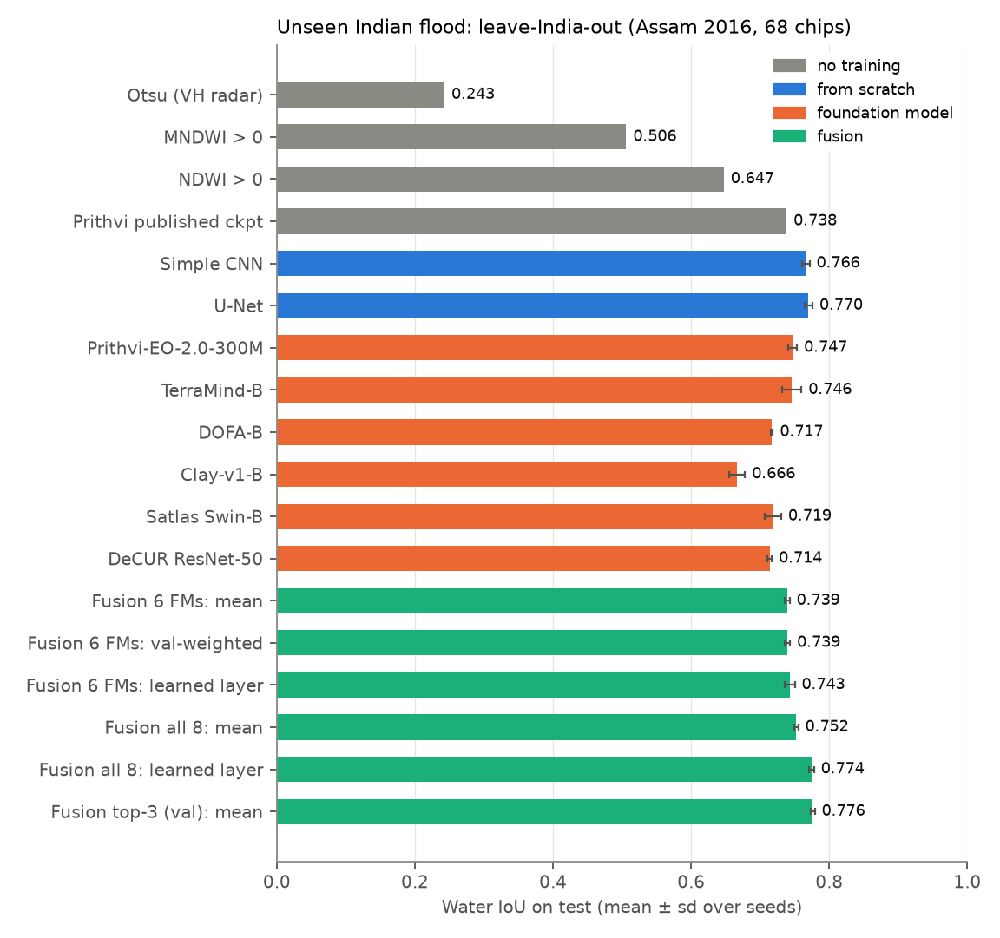

- **On the flood the models had never seen (Assam, Table A) the best single models are the two trained from
  scratch**: U-Net 0.770 ± 0.006 and the simple CNN 0.766 ± 0.005. The best foundation models, Prithvi-EO-2.0
  (0.747 ± 0.006) and TerraMind-B (0.746 ± 0.014), are about 0.02 IoU lower; Satlas, DOFA and DeCUR are at
  0.714–0.719 and Clay at 0.666.
- **On the official split (Table B)** U-Net and CNN reach 0.840; the foundation models range from 0.802 (Clay)
  to 0.829 (Prithvi).
- **Without training**, Otsu thresholding of radar VH gets 0.23–0.24, NDWI 0.65–0.76. The published Prithvi
  flood checkpoint gets 0.738 on Assam, but it is not an unseen-event score: 40 of the 68 Assam chips were in
  its training set and 14 in its validation set.
- With ~250 labelled chips and all 15 bands available, pre-training on large unlabelled archives did not
  beat a well-trained U-Net for this task. Water has a strong spectral signature (NDWI alone reaches 0.65–0.76),
  and a 7.8 M-parameter network learns it from a few hundred chips. Training time: 2–6 min for U-Net,
  5–31 min for the foundation models on one GPU of the shared server.

The project scope listed CROMA, Galileo and TerraFM. None of them is in the backbone registry of TerraTorch
1.2.13 (1,467 backbones checked), the framework that gives all models here the same decoder, loss and data
pipeline. Adding them would have meant a second, different training pipeline, so they were replaced by Clay,
Satlas and SSL4EO-S12 DeCUR, which are in the same framework.

### 4.2 How much is lost on an unseen flood

Every model loses 0.07–0.14 IoU when the Indian event is not in training: U-Net 0.840 → 0.770, Prithvi
0.829 → 0.747, TerraMind 0.821 → 0.746, Clay 0.802 → 0.666. On the official split the India event itself is
scored at 0.86–0.92 by the trained models (Table F) because the model has seen other chips of the same flood. **For a new Indian
flood, the leave-India-out numbers are the ones to expect**, and this is the gap the mid-term result fell into.

### 4.3 Frozen encoder vs full fine-tuning

**Table C. Frozen encoder vs full fine-tuning** (test water IoU; frozen = seed 0, fine-tuned = mean of seeds).

| Model | LIO frozen | LIO fine-tuned | Δ | Official frozen | Official fine-tuned | Δ | Trainable params frozen (M) |
|---|---|---|---|---|---|---|---|
| Prithvi-EO-2.0-300M | 0.723 | 0.747 | +0.024 | 0.808 | 0.829 | +0.021 | 20.3 |
| TerraMind-B | 0.714 | 0.746 | +0.032 | 0.825 | 0.821 | -0.004 | 15.5 |
| DOFA-B | 0.677 | 0.717 | +0.039 | 0.808 | 0.820 | +0.012 | 15.5 |
| Clay-v1-B | 0.619 | 0.666 | +0.047 | 0.774 | 0.802 | +0.028 | 15.5 |
| Satlas Swin-B | 0.670 | 0.719 | +0.048 | 0.786 | 0.819 | +0.032 | 5.1 |
| DeCUR ResNet-50 | 0.711 | 0.714 | +0.003 | 0.828 | 0.827 | -0.002 | 9.0 |

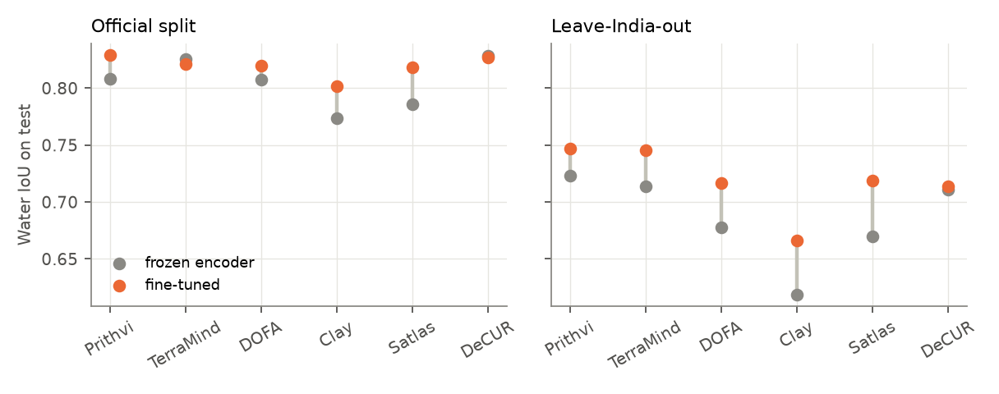

On the unseen flood, fine-tuning helps every foundation model, by +0.003 (DeCUR) to +0.048 (Satlas). On the
official split, frozen TerraMind (0.825) and frozen DeCUR (0.828) are as good as their fine-tuned versions,
while only 5–20 M decoder parameters are trained. What pre-training gives for free is enough for events like
those in training; moving to a new region needs the encoder to adapt.

### 4.4 Fusion ("fuse layer")

**Table E. Fusion of the six fine-tuned foundation models** (test IoU, mean ± sd over seeds; best single model for reference).

| Variant | LIO (Assam) | Official | Bolivia (LIO models) |
|---|---|---|---|
| Best single FM by validation (TerraMind-B / TerraMind-B) | 0.746 ± 0.014 | 0.821 ± 0.000 | 0.793 ± 0.019 |
| Fusion 6 FMs: mean | 0.739 ± 0.004 | 0.837 ± 0.012 | 0.818 ± 0.004 |
| Fusion 6 FMs: val-weighted | 0.739 ± 0.004 | 0.837 ± 0.012 | 0.818 ± 0.004 |
| Fusion 6 FMs: learned layer | 0.743 ± 0.007 | 0.825 ± 0.007 | 0.805 ± 0.004 |
| Fusion all 8: mean | 0.752 ± 0.003 | 0.840 ± 0.011 | 0.817 ± 0.004 |
| Fusion all 8: learned layer | 0.774 ± 0.004 | 0.836 ± 0.001 | 0.804 ± 0.006 |
| Fusion top-3 (val): mean | 0.776 ± 0.003 | 0.842 ± 0.001 | 0.801 ± 0.006 |

Learned fuse-layer weights (official_ens, seed 0): clay +0.02, decur +0.01, dofa +0.17, prithvi +0.25, satlas -0.04, terramind +0.23.
Learned fuse-layer weights (official_ensall, seed 0): clay -0.13, cnn +0.15, decur +0.01, dofa +0.12, prithvi +0.14, satlas -0.06, terramind +0.19, unet +0.22.
Learned fuse-layer weights (lio_ens, seed 0): clay -0.09, decur +0.16, dofa +0.09, prithvi +0.27, satlas -0.04, terramind +0.30.
Learned fuse-layer weights (lio_ensall, seed 0): clay -0.16, cnn +0.28, decur +0.10, dofa +0.00, prithvi +0.22, satlas -0.10, terramind +0.23, unet +0.10.

- Fusing the six foundation models does **not** beat the best one on the unseen flood (0.739–0.743 vs
  0.746–0.747), but helps on the official split (0.837 vs 0.829).
- Adding the two from-scratch models to the pool changes this: the learned fuse layer over all eight reaches
  0.774 ± 0.004, and the mean of the three models with the best validation IoU (always U-Net and CNN, plus Prithvi in seed 0 and TerraMind in seeds 1 and 2) reaches
  **0.776 ± 0.003, the best leave-India-out result, with a small spread between seeds**.
- The learned weights give Clay and Satlas zero or negative weight and TerraMind and Prithvi the largest
  weights among the foundation models; the fuse layer learns which members to ignore.

### 4.5 Radar, optical or both?

**Table D. Which sensor is needed? Modality ablation on the unseen Indian flood** (LIO test IoU, mean ± sd over seeds).

| Model | Radar only (S1) | Optical only (S2) | Radar + optical |
|---|---|---|---|
| U-Net | 0.513 ± 0.007 | 0.763 ± 0.006 | 0.770 ± 0.006 |
| TerraMind-B | 0.505 ± 0.021 | 0.755 ± 0.002 | 0.746 ± 0.014 |

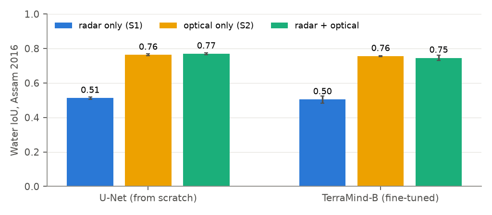

Radar alone gives 0.51 on Assam, optical alone 0.76, both 0.75–0.77. This test favours optical by
construction: Sen1Floods11 labels were drawn on the Sentinel-2 image, and pixels under cloud are labelled
"unknown" and excluded from scoring. During a monsoon flood the optical image is mostly cloud (61–95 % over the
Mahanadi delta on the flood dates, §6), so radar is the only sensor that sees the event. This answers the
team's dataset questions of 20 October: optical bands are the better input whenever the sky is clear, but the
operational flood map has to work from radar; Section 6 therefore uses the radar-only models.

### 4.6 Threshold calibration, events, and flood vs permanent water

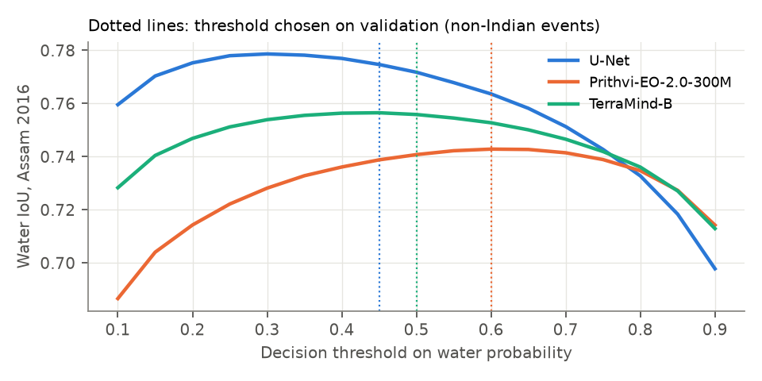

- Choosing the decision threshold on validation (0.33–0.60 for the trained models) changes test IoU by
  less than 0.01; 0.5 is adequate for trained models. It matters for index methods (MNDWI 0.506 → 0.602) and for
  degraded input (on the 20 m radar of §6, 0.30 for the pair trained at 10 m and 0.45 for the pair retrained at
  20 m that maps the atlas).
- Water that is not JRC permanent water (closer to "flood") scores about 0.05 lower than all water for every
  model (U-Net 0.722 vs 0.770 on Assam).
- By event (Table F): Mekong, Nigeria and Sri Lanka score above 0.9 and India 0.86–0.92; Ghana (0.53–0.66), Paraguay and
  Pakistan are hardest. Bolivia, never trained on, is 0.75–0.82.

**Table F. Per-event test IoU, official split** (mean over seeds; fine-tuned models and baselines).

| Event | Otsu (VH radar) | MNDWI > 0 | NDWI > 0 | Prithvi published ckpt | Simple CNN | U-Net | Prithvi-EO-2.0-300M | TerraMind-B | DOFA-B | Clay-v1-B | Satlas Swin-B | DeCUR ResNet-50 | Fusion 6 FMs: mean | Fusion 6 FMs: val-weighted | Fusion 6 FMs: learned layer | Fusion all 8: mean | Fusion all 8: learned layer | Fusion top-3 (val): mean |
|---|---|---|---|---|---|---|---|---|---|---|---|---|---|---|---|---|---|---|
| Ghana | 0.11 | 0.67 | 0.51 | 0.57 | 0.57 | 0.58 | 0.56 | 0.55 | 0.57 | 0.62 | 0.58 | 0.66 | 0.59 | 0.59 | 0.53 | 0.59 | 0.53 | 0.57 |
| India | 0.39 | 0.71 | 0.81 | 0.88 | 0.91 | 0.91 | 0.89 | 0.89 | 0.88 | 0.86 | 0.89 | 0.88 | 0.89 | 0.89 | 0.90 | 0.90 | 0.91 | 0.92 |
| Mekong | 0.31 | 0.82 | 0.93 | 0.91 | 0.95 | 0.95 | 0.92 | 0.91 | 0.91 | 0.90 | 0.91 | 0.91 | 0.92 | 0.92 | 0.92 | 0.93 | 0.94 | 0.95 |
| Nigeria | 0.30 | 0.91 | 0.89 | 0.92 | 0.94 | 0.94 | 0.93 | 0.93 | 0.92 | 0.92 | 0.93 | 0.92 | 0.93 | 0.93 | 0.93 | 0.93 | 0.94 | 0.94 |
| Pakistan | 0.21 | 0.72 | 0.57 | 0.68 | 0.73 | 0.74 | 0.75 | 0.72 | 0.64 | 0.73 | 0.55 | 0.65 | 0.71 | 0.71 | 0.69 | 0.72 | 0.71 | 0.73 |
| Paraguay | 0.17 | 0.37 | 0.53 | 0.75 | 0.63 | 0.63 | 0.66 | 0.61 | 0.72 | 0.60 | 0.76 | 0.74 | 0.73 | 0.73 | 0.65 | 0.68 | 0.63 | 0.63 |
| Somalia | 0.16 | 0.57 | 0.71 | 0.77 | 0.85 | 0.85 | 0.80 | 0.80 | 0.78 | 0.71 | 0.79 | 0.78 | 0.80 | 0.80 | 0.80 | 0.82 | 0.83 | 0.85 |
| Spain | 0.41 | 0.75 | 0.79 | 0.81 | 0.86 | 0.86 | 0.84 | 0.84 | 0.83 | 0.81 | 0.82 | 0.82 | 0.84 | 0.84 | 0.84 | 0.85 | 0.86 | 0.86 |
| Sri-Lanka | 0.23 | 0.55 | 0.90 | 0.92 | 0.93 | 0.93 | 0.93 | 0.92 | 0.92 | 0.91 | 0.91 | 0.92 | 0.93 | 0.93 | 0.93 | 0.94 | 0.94 | 0.94 |
| USA | 0.08 | 0.77 | 0.70 | 0.77 | 0.81 | 0.81 | 0.80 | 0.81 | 0.79 | 0.73 | 0.78 | 0.78 | 0.80 | 0.80 | 0.81 | 0.81 | 0.83 | 0.82 |

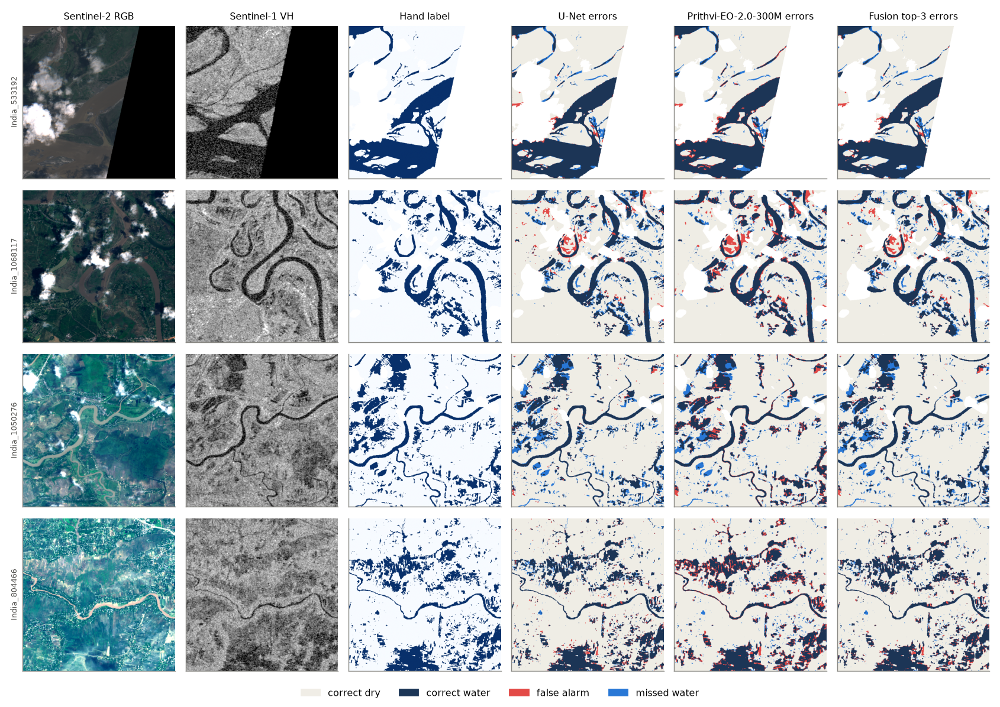

### 4.7 Label efficiency

**Table G. Label efficiency on the unseen Indian flood** (LIO test IoU, mean ± sd over seeds; nested subsets of the 212 non-Indian training chips; epochs scaled so every run gets ~1,000 updates).

| Model | 21 chips (10 %) | 53 chips (25 %) | 106 chips (50 %) | 212 chips (100 %) |
|---|---|---|---|---|
| Prithvi-EO-2.0-300M | 0.687 ± 0.015 | 0.711 ± 0.004 | 0.744 ± 0.009 | 0.747 ± 0.006 |
| TerraMind-B | 0.694 ± 0.009 | 0.715 ± 0.002 | 0.741 ± 0.015 | 0.746 ± 0.014 |
| U-Net | 0.736 ± 0.006 | 0.756 ± 0.015 | 0.773 ± 0.007 | 0.770 ± 0.006 |

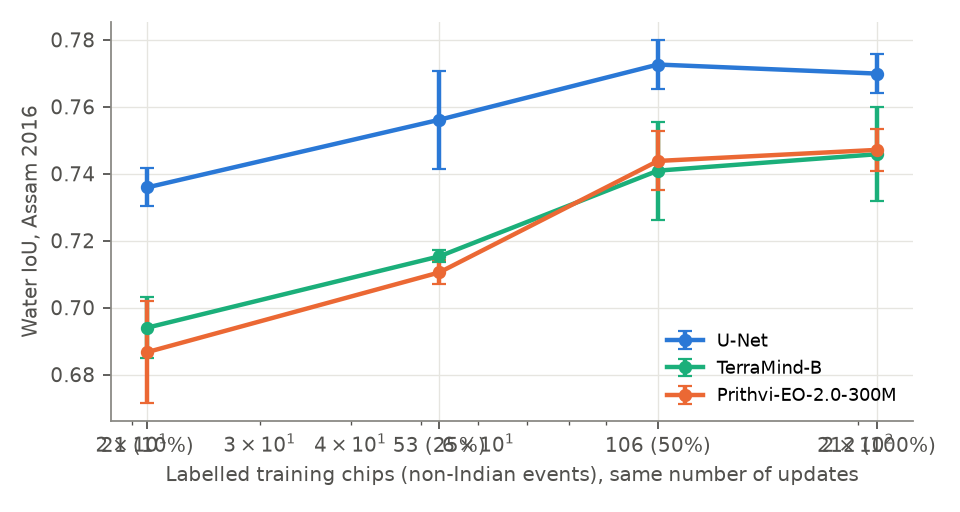

With only 21 training chips U-Net reaches 0.736, about what Prithvi and TerraMind reach with all 212 (0.747,
0.746). Every model is within 0.01 of its full-data score at 106 chips. In this task, foundation models are
not more label-efficient than a U-Net.

### 4.8 What we take forward

1. **Model for a clear-sky Indian flood map**: U-Net, or the top-3 fusion (U-Net + CNN + the best foundation model) when the extra cost is acceptable.
2. **Model for the monsoon (radar only)**: radar-only models score 0.65 on the official split and 0.51 on
   Assam. TerraMind-B is the only foundation model here that takes radar alone as a native input; averaged
   with a radar-only U-Net it gives 0.664 (official test), better than either alone (0.654, 0.649). This
   radar fusion, retrained on the 20 m radar the atlas reads (Appendix B), is the production model of the
   Mahanadi atlas (§6).
3. **The foundation model's value in this project** is not a higher score on Sen1Floods11; it is that one
   pre-trained network takes optical, radar or both without redesign, which is what an operational system
   that loses its optical images under monsoon cloud needs.

## 5. Physics track: Saint-Venant equations and the PINN

All numbers below were produced on the lab server (CPU, TensorFlow 1.15 in a Python 3.7 environment
built with micromamba; same package pins as the repository's `SETUP.sh`). Logs are in `pinn/results/logs/`,
figures in `pinn/results/figures/`. The case number for our team was never assigned, so we used **case 3**
(the reach the Phase-2 exercise is written against) for all from-scratch work, and validated all six
cases from the published weights.

### 5.1 Environment check and reproduction of every case (published weights)

`python phase4_validation/validate.py --case N`

| Case | Reach | ε_h (ours) | ε_h (paper) | RMSE | NSE | Deviation |
|---|---|---|---|---|---|---|
| 1 | analytical, flat bed | 3.0750e-03 | 3.075e-03 | 0.001 m | 0.9999 | 0.0 % |
| 2 | analytical, sloping bed | 3.6845e-02 | 3.685e-02 | 0.076 m | 0.9952 | 0.0 % |
| 3 | HEC-RAS sub-reach | 6.6354e-03 | 6.635e-03 | 0.054 m | 0.9997 | 0.0 % |
| 4 | same reach, 10× longer | 3.0928e-01 | 3.093e-01 | 1.771 m | 0.7837 | 0.0 % |
| 5 | full reach | 9.8755e-02 | 9.876e-02 | 0.387 m | 0.9294 | 0.0 % |
| 6 | full reach, 2 gauges (Fourier features) | 1.3962e-01 | 1.396e-01 | 0.674 m | 0.9080 | 0.0 % |

Linear interpolation between gauges, for comparison: ε_h = 0.519 (case 5, NSE −0.95) and 0.369
(case 6, NSE 0.36). The PINN is 5× (case 5) and 2.6× (case 6) more accurate than interpolation on
the same gauges.

### 5.2 Phase 1 — what the network is shown (case 3)

4,896 collocation points carry physics only. Initial profile, both boundaries and two interior gauges
(cross-sections 16 and 32) carry data: **the model sees 8.9 % of the reference field** and has to
reconstruct the other 91.1 % from the equations. Figure: `case3_phase1_overview.png`.

### 5.3 Phase 2 — residuals written from the equations (completed exercise)

`pinn/p2b_residuals_completed.py` implements the two residuals and checks them against the engine on
every collocation point:

| | Case 3 (4,896 pts) | Case 5 (36,567 pts) |
|---|---|---|
| continuity: max |ours − engine| | 0.000 → MATCH | 0.000 → MATCH |
| momentum: max |ours − engine| | 0.000 → MATCH | 0.000 → MATCH |
| mean |continuity residual| of the trained model | 1.53e-01 | 4.56e-02 |
| mean |momentum residual| of the trained model | 6.64e-02 | 1.70e-01 |

What the engine actually implements (the three "traps"):

1. **Continuity is non-conservative.** The engine uses `h_t + u·h_x = 0`; the full form for a
   rectangular channel is `h_t + u·h_x + h·u_x = 0`. The two agree only if velocity is uniform along
   the reach (`u_x ≈ 0`). Evaluated on the trained solution, the dropped term `|h·u_x|` is on average
   **5 % of the retained terms on case 3** (mean 8.4e-3, max 2.9e-2) but **23 % on case 5**
   (median 11 %, max 0.13). The assumption is acceptable on the 1 km case-3 reach and clearly
   violated on the longer case-5 reach, where mass is not conserved by the loss the network minimises.
2. **Manning's n is hard-coded to 0.015** inside `fun_r_momentum` (`engine/SVE_module_dynamic_h.py:381`);
   the value passed to the constructor is ignored.
3. **Friction uses |u|u, not u².** With u² the friction term would accelerate reverse flow instead of
   opposing it. `tf.pow(tf.square(R), 2/3)` equals `R^(4/3)` for R > 0; squaring first keeps the power's
   argument non-negative during training.

Loss balance at the trained optimum (case 3, `p2c_loss_balance.py`): continuity 3.0e-2, momentum 2.5e-2,
upstream/downstream velocity boundary 3.1e-2, depth boundary 3.7e-3, initial depth 3.7e-3, gauge
observations 6.7e-4 (u) and 5.5e-4 (h). The physics and velocity-boundary terms dominate; the gauges
are fitted almost exactly because their adaptive weights grow to 128 (u) and 55 (h).

### 5.4 Phase 3 — retraining case 3 from scratch

`python phase3_training/train.py --case 3` (8,000 Adam iterations, seed 1234), then
`validate.py --case 3 --trained`:

| Run | ε_h | RMSE | NSE | vs paper |
|---|---|---|---|---|
| Published weights | 6.635e-03 | 0.054 m | 0.9997 | — |
| **Our retrain, Adam + L-BFGS-B** | **6.457e-03** | **0.052 m** | **0.9997** | **2.7 % better** |
| Our retrain, `--no-bfgs` (Adam only) | 6.457e-03 | 0.052 m | 0.9997 | identical |

Training took 334 s on CPU. Figure: `case3_trained_profiles.png` (PINN vs HEC-RAS reference at four
times; the only visible miss is the drawdown near the upstream end at the last time step).

### Finding: the L-BFGS-B stage does nothing on case 3

`docs/05_known_issues.md` (item 1) states that the L-BFGS-B refinement "is where most of the published
accuracy comes from". In our run it changed nothing:

- `train_bfgs_safe` (the course wrapper) evaluates the loss at 3.212 with the adaptive weights pinned
  at their final Adam values.
- The first trial step blows the momentum residual up to 3.07e+08; the line search returns to the
  start point and SciPy stops after 16 evaluations with the weights unchanged (log lines 2439–2454
  of `train_case3.log`).
- Consequently the Adam-only run gives a bit-identical ε_h (6.4574e-03).

So, for case 3, all of the accuracy comes from the 8,000 Adam iterations, and our Adam-only model is
already 2.7 % better than the published one. Whether L-BFGS-B helps on the longer cases (4–6) remains
open; the first thing to check is the initial step size (the wrapper uses SciPy's defaults).

### 5.5 Classical solver for comparison (`sve_demo.py`)

The MacCormack finite-difference solver from the mid-term report (Appendix A.1) was restored as a
runnable script. It reproduces the mid-term numbers exactly: peak 400 → 313.7 m³/s at 8 km (+0.76 h)
→ 229.8 m³/s at 20 km (+2.25 h). Figure: `sve_demo_hydrographs.png`.

### 5.6 Verdict (Phase 4 question: would we recommend it to a river agency with two gauges?)

On a short reach with a calibrated HEC-RAS model already available (case 3), no: the PINN reproduces
HEC-RAS to 5 cm RMSE, but it needs HEC-RAS boundary series to do so and adds 5–6 minutes of training per
reach. Its real value appears on long reaches with sparse gauges (cases 5–6), where it beats linear
interpolation by a factor of 2.6–5 in ε_h. Even there two caveats from this work apply: the
continuity residual drops a term that is 11–23 % of the retained terms on case 5, and the published
observations are noise-free (SNR 500 dB), so robustness to real gauge error is untested.

## 6. Mahanadi delta: flood atlas and the link to river flow

### 6.1 The atlas

The production model of §4.8 (mean of the radar-only TerraMind-B and U-Net, retrained on 20 m input as in Appendix B, threshold 0.45) was run on
**590 Sentinel-1 passes** (133 in February–March, 457 in June–November,
2017–2026; tracks ascending 85: 184; descending 48: 211; descending 121: 195; platforms S1A 521, S1B 41, S1D 28).
A pass is all slices of one satellite overpass; together they give a water map of the delta every 2–6 days in the
monsoon. The river bed (main channels and sand bars, 178 km²) and each year's
dry-season water are "normal water"; only water outside them counts as flood. A 3 km band along each pass's data
edge is removed: a first version showed a diagonal stripe of false floods along one track's swath edge.

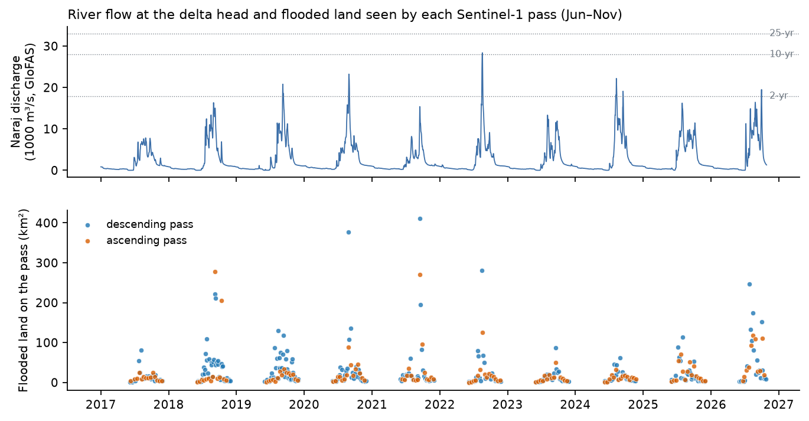

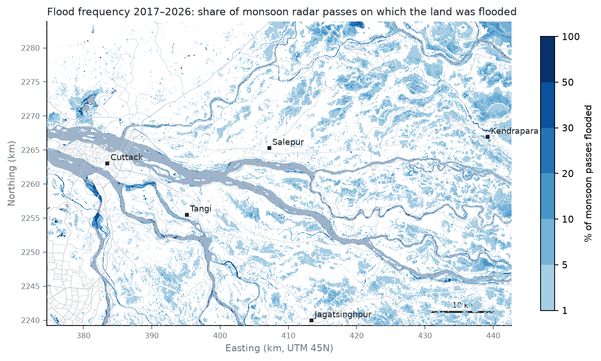

- Land flooded on at least one pass: 1,137 km²; in at least 20 % of monsoon passes:
  26 km².
- The largest flood seen on a near-complete pass was on 2018-09-08 (278 km² of flooded land).
- The flooded fraction of each pass follows the Naraj flow. Spearman ρ by predictor:
  same-day flow 0.758, previous-day flow 0.760, 3-day peak 0.765, 5-day peak 0.764, 7-day peak 0.760; the 3-day peak is used
  (the five are practically tied: floodplains drain slowly, so any recent peak works).

### 6.2 Independent check with Sentinel-2

For 60 radar passes of June–November a Sentinel-2 image was taken within one day with enough clear
sky (most of them at the end of the monsoon). On the pixels that are clear in the optical image, radar water agrees with
optical water (MNDWI > 0) with IoU **0.56**; taking the optical map as reference, the radar map has
precision 0.75 and recall 0.69. For water outside the normal-water mask — the flood
part — agreement drops to IoU 0.20 (precision 0.63, recall 0.22): the
radar misses much of the shallow water that the optical image sees among crops and on water-logged fields, where the crop
canopy dominates the radar echo. MNDWI has errors of its own (0.65 on the Sen1Floods11 official test, and wet soil
reads as water), so neither map is truth; but the low flood-part recall says the radar atlas under-states shallow
field flooding and is most reliable for open water. The field points (§8.3) are the next check.

### 6.3 Trigger discharge: which flow floods which land

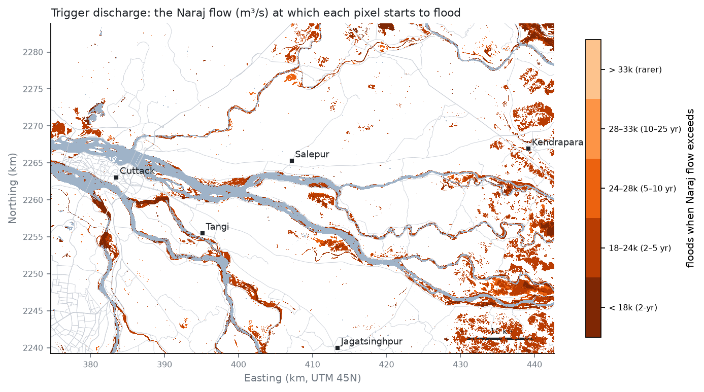

Every pixel gets the Naraj flow above which it is flooded (§3.5). The map reads directly as "at this forecast
flow, this land goes under". The river-driven score separates land that floods with the river from land that is wet
in the monsoon whatever the river does: 749 km² has AUC ≥ 0.75, i.e. it floods mainly at
high river flow, including fields far from the channels that flood when high river stages block their drainage.

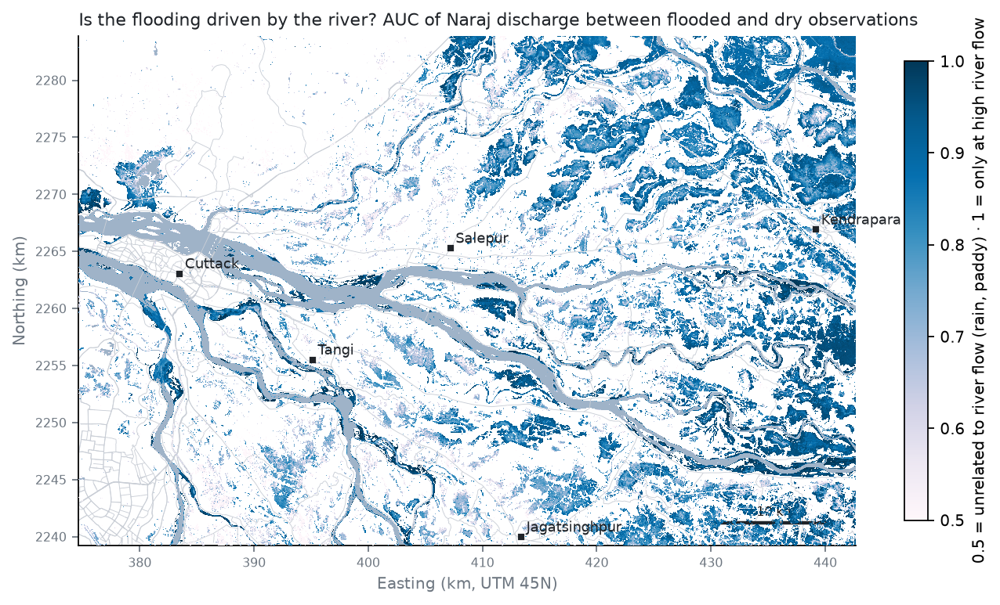

### 6.4 Does it predict years it has not seen?

For each year the trigger map was fitted on the other years and the year's passes were predicted from their discharge
alone.

| Year | Passes | Largest flood on a pass (km²) | IoU, discharge model | IoU, climatology |
|---|---|---|---|---|
| 2017 | 39 | 81 | 0.17 | 0.14 |
| 2018 | 57 | 278 | 0.13 | 0.06 |
| 2019 | 63 | 129 | 0.18 | 0.09 |
| 2020 | 46 | 377 | 0.14 | 0.06 |
| 2021 | 46 | 411 | 0.10 | 0.07 |
| 2022 | 43 | 280 | 0.28 | 0.08 |
| 2023 | 41 | 87 | 0.25 | 0.16 |
| 2024 | 43 | 61 | 0.21 | 0.16 |
| 2025 | 45 | 114 | 0.20 | 0.10 |
| 2026 | 34 | 246 | 0.16 | 0.05 |

Over all 457 monsoon passes the discharge model reaches IoU 0.17 (precision
0.55, recall 0.20) against 0.08 for
climatology. **On the 66 high-flow passes (Naraj ≥ 9,682 m³/s, the top 10 % of monsoon
days), the ones that matter for warnings, it reaches 0.20 against 0.04**
(recall 0.25 vs 0.04): climatology misses the extra land that only
floods in big years. Predicted and observed flooded area correlate with r = 0.39.

Pixel IoU is a hard score here: the observed map is itself a radar map with ~0.65 IoU, and floodplain flooding is
patchy. A warning is issued per village, so the same held-out test was scored per settlement (1,082
settlements; flagged when at least 10 % of the people are on flooded land). **On high-flow passes the trigger map
flagged 21% of the settlements that were actually flooded (POD), with 62% false alarms (FAR),
CSI 0.16; climatology: POD 2%, FAR 40%, CSI 0.02.** Over all monsoon
passes: POD 19%, FAR 57%, CSI 0.15.

**Where versus how much.** Ranking the pixels of each held-out pass, the flood frequency of the other years reaches
ROC AUC 0.91 (high flows 0.90), the trigger map
0.72 and the flow-and-rain analogs 0.77. *Where* the delta floods is
very predictable from its past; *how much* of it floods on a given day is only partly predictable from river flow.
Both layers are kept: the frequency map says where to prepare, the trigger map says at which flow to act.

**The river is not the only driver.** The largest flood extents in the record came with moderate Naraj
flows (the largest flow seen is 28,378 m³/s): 14 September 2021 (411 km², Naraj flow 11,614 m³/s, 231 mm of ERA5 rain in the week before, with a Bay of Bengal depression) and 26 August 2020 (377 km², Naraj flow 14,487 m³/s, 187 mm of ERA5 rain in the week before). A map driven by Naraj flow
alone cannot predict those. The same held-out test was therefore repeated with
analog maps: for each pass of the held-out year, the 7 training passes most similar in flow (or in flow and
7-day rain) are looked up, and land flooded on at least half of them is predicted
flooded.

| Method | IoU, all passes | IoU, high flow (≥ 9,682 m³/s) | IoU, heavy rain (≥ 135 mm in 7 days) | Settlements, high flow: POD / FAR | Settlements, heavy rain: POD / FAR |
|---|---|---|---|---|---|
| Trigger map (flow only) | 0.17 | 0.20 | 0.15 | 21% / 62% | 14% / 63% |
| Analogs on flow | 0.16 | 0.18 | 0.13 | 14% / 58% | 8% / 46% |
| Analogs on flow + local rain | 0.17 | 0.19 | 0.16 | 12% / 67% | 10% / 65% |
| Flood climatology | 0.08 | 0.04 | 0.03 | 2% / 40% | 1% / 50% |

On the heavy-rain passes the best method is the flow-and-rain analogs (IoU 0.16), and
adding rain to the analogs raises their IoU from 0.13 to 0.16, only 0.01 above the trigger map:
at the scale of single passes rain is hard to use because the observed maps are noisy. The effect of rain is clear
when the same method is asked about the same river flow. With the same analog method and the 5-year flow (23,940 m³/s), a dry week (20 mm of rain) gives 27 km² of flooded land with 5,232 people on it; a week with 171 mm (the monsoon 95th percentile) gives 93 km² and 13,540 people.
For warnings this means the river forecast has to be read together with the rainfall forecast, which the ClimMaTech
app already carries.


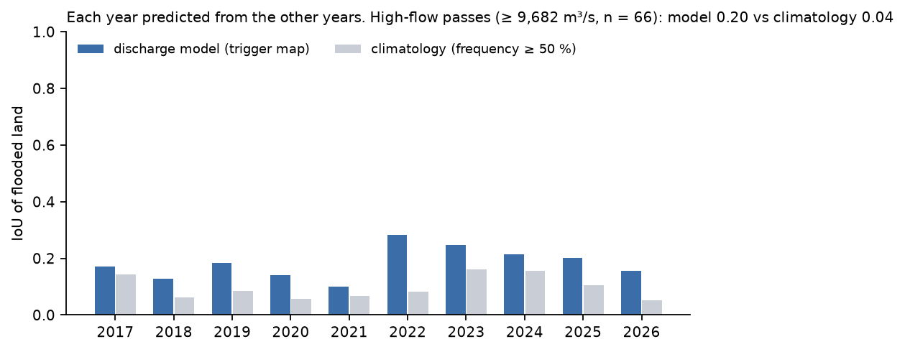

### 6.5 Design floods and travel time

Gumbel fit to 29 GloFAS annual maxima at Naraj (1997–2025):

| Return period (years) | Naraj flow (m³/s) | (lakh cusec) | Flooded land (km²) |
|---|---|---|---|
| 2 | 17,897 | 6.3 | 50 |
| 5 | 23,940 | 8.5 | 218 |
| 10 | 27,941 | 9.9 | 240 |
| 25 | 32,997 | 11.7 | 240 (lower bound) |
| 50 | 36,747 | 13.0 | 240 (lower bound) |
| 100 | 40,470 | 14.3 | 240 (lower bound) |

The largest flow in the radar record is 28,378 m³/s; above it the map cannot grow
further and is a lower bound (25-yr, 50-yr, 100-yr).

Day-to-day changes of flow below Hirakud correlate best with those at Naraj
1 day later (r = 0.47),
and those at Tikarpara on the same day (r = 0.93),
in June–October 1997–2025 (daily data resolve only whole days). A release seen by a spillway sensor at Hirakud
therefore gives about a day of lead time for the delta, on top of the hydrological forecast.

### 6.6 A learned flow + rain + history model

The trigger map uses the Naraj flow alone, and the analogs use rain only through similar past passes. A gradient-boosted
classifier (scikit-learn HistGradientBoosting, `mahanadi/learned_flood_model.py`) was trained on pixels of every monsoon
pass with the flow and 7-day rain of the pass, its month and radar track, and what the training years say about each
pixel: trigger discharge, flood frequency overall, at high flows and in heavy rain, height above the nearest river bed
and distance to it. Each year is predicted by a model fitted on the other years, a pixel is called flooded when its
probability is at least 0.5 (the per-pixel error-minimising rule of the trigger fit), and the three methods are scored
on the same held-out passes. Cells give IoU (precision / recall).

| Held-out passes | Learned model | Trigger map | Flood climatology |
|---|---|---|---|
| All monsoon passes (457) | 0.20 (0.45 / 0.27) | 0.17 (0.55 / 0.20) | 0.08 (0.61 / 0.09) |
| High flow (66) | 0.24 (0.40 / 0.37) | 0.20 (0.50 / 0.25) | 0.04 (0.86 / 0.04) |
| Heavy rain (46) | 0.22 (0.36 / 0.35) | 0.15 (0.50 / 0.18) | 0.03 (0.78 / 0.03) |
| Settlements, high flow: POD / FAR | 28% / 71% | 21% / 62% | 2% / 40% |
| Settlements, heavy rain: POD / FAR | 23% / 74% | 14% / 63% | 1% / 50% |
| Ranking AUC, all / high flow | 0.95 / 0.92 | 0.72 / 0.72 | 0.91 / 0.90 |

The learned model is better than the trigger map on all passes and on heavy-rain passes. At village level, at high flows, it catches more flooded villages
than the trigger map (28% against 21%) and raises
more false alarms (71% against
62%); the critical success index, which weighs both, is 0.17 against
0.16. It ranks flood-prone land
best of the three
(ROC AUC 0.95). The physical direction of each input is imposed (more flow or rain, a
flow further above the trigger or a pixel that flooded more often never lowers the probability):
a first run without these constraints (on the earlier atlas of Appendix B) scored 0.233 IoU but gave less flooded land for heavy than for typical rain at the 25-year flow (108 against 121 km²), which a warning map must never do.
The inputs it leans on most (drop in held-out ranking AUC when each is shuffled):
flood frequency 0.138; Naraj flow 0.036; 7-day rain 0.032; month 0.016; radar track 0.014. Fitted on all years, it floods
30 km² at the 5-year flow in a dry week,
44 km² with typical rain and 142 km²
with heavy rain (August, averaged over the three radar tracks; typical rain = median 7-day rain of the monsoon passes (58 mm); heavy rain = monsoon 95th percentile (171 mm)), a roughly five-fold
effect of rain between a dry and a heavy-rain week (the analog maps of §6.4 give three-fold: 27 against 93 km²).
For a warning system this is the model that takes both of
ClimMaTech's inputs, the river forecast and a rain-gauge or forecast rain total, and returns one map.

### 6.7 Forecasting the flow at Naraj

A flood map is only as early as the flow forecast behind it. The trigger map turns a Naraj flow into a map; this
section asks how far ahead that flow can be known from what is measured upstream today. Water reaches Naraj from the
Hirakud reach and the Tel and Ong tributaries in about a day (§6.5), so the flows at Naraj, Tikarpara and below Hirakud
on the issue day and the two days before, their last-day changes, ERA5 rain over the catchment between Hirakud and Naraj
(eight points; the day, the day before, 3- and 7-day sums) and the season predict the change in the Naraj flow one,
two and three days ahead. One gradient-boosted model per lead time (scikit-learn HistGradientBoosting,
`mahanadi/forecast_model.py`) was trained on 1997–2015 and tested on the June–November
days of 2016–2026, which it never saw. Baselines: persistence (the flow stays as it is)
and linear routing (log-flows at the three gauges). A second variant adds the rain of the coming days as if it were
forecast perfectly, the most a rain forecast can add.

| Lead | Persistence | Linear routing | Model (KGE) | Model + rain forecast | 2-year flood, persistence: caught / false | Model | Model + rain forecast |
|---|---|---|---|---|---|---|---|
| 1 day | 0.963 | 0.980 | 0.987 (0.99) | 0.988 | 77% / 23% | 77% / 0% | 77% / 5% |
| 2 days | 0.882 | 0.882 | 0.941 (0.97) | 0.948 | 58% / 42% | 62% / 33% | 73% / 32% |
| 3 days | 0.788 | 0.747 | 0.885 (0.94) | 0.892 | 42% / 58% | 50% / 50% | 58% / 38% |

Cells give Nash–Sutcliffe efficiency of the daily flow (1 = perfect), and for the 17,897 m³/s
two-year flow the share of exceedance days caught and the share of forecast exceedances that were false. The model keeps
its skill where persistence fades: three days ahead its efficiency is 0.89 against
0.79, and one day ahead it catches the two-year flood as often as persistence with
0% instead of 23% false alarms.
A rain forecast adds little to the efficiency but most where it matters: two and three days ahead it raises the
two-year floods caught from 62% to 73%
and from 50% to 58%.
The flows are GloFAS reanalysis, the series the atlas is fitted on; with CWC records or Pravaah-type gauges upstream the
same code trains on measured flows, and the forecast runs in the live feed of §9.7 next to the GloFAS ensemble.

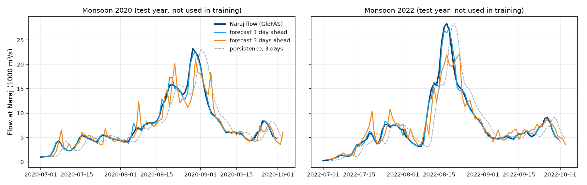

### 6.8 The same pipeline on two more basins

Nothing in the method is specific to the Mahanadi. A basin is a box, a GloFAS cell on the main river (checked by its
mean flow), the months of the dry season and of the flood season (`mahanadi/basins.py`). The Brahmani–Baitarani delta
next door (Jajpur, Kendrapara and Bhadrak districts) and the Brahmaputra around Majuli in Assam, the region of the
benchmark's unseen Indian flood, went through the same chain: every Sentinel-1 pass since 2017 at 20 m, the production
radar pair at threshold 0.45, the trigger map with its held-out-year test, Gumbel design floods, exposure, the
flow-impact tables of §9.7 and the Sentinel-2 check (`server/run_basins_pull.sh`, `run_basins_context.sh`,
`run_basin_atlas.sh`).

| Basin | Gauge | Passes | Flooded at least once (km²) | 25-year flow (m³/s) | Flooded land, 25-year (km²) | People on it | Held-out high flows: trigger vs climatology (IoU) | Sentinel-2 agreement (IoU) |
|---|---|---|---|---|---|---|---|---|
| Mahanadi delta | Mahanadi at Naraj | 590 | 1,137 | 32,997 | 240 | 30,427 | 0.20 vs 0.04 | 0.56 |
| Brahmani–Baitarani delta | Brahmani at Jenapur | 394 | 2,277 | 6,959 | 950 | 129,662 | 0.17 vs 0.01 | 0.65 |
| Brahmaputra at Majuli | Brahmaputra at Neamatighat | 346 | 2,145 | 42,202 | 1,120 | 77,655 | 0.31 vs 0.05 | 0.67 |

**Brahmani–Baitarani delta.** 394 usable passes; 2,277 km² flooded at least once; the largest flood seen, on 2026-08-16, covered 1,168 km² with 131,620 people on it. The 25-year flow (6,959 m³/s) maps 950 km² with 129,662 people, a lower bound because the largest flow on a pass was 6,108 m³/s; warnings start at 3,500, 3,500 and 4,250 m³/s.

**Brahmaputra at Majuli.** 346 usable passes; 2,145 km² flooded at least once; the largest flood seen, on 2017-07-09, covered 1,246 km² with 137,306 people on it. The 25-year flow (42,202 m³/s) maps 1,120 km² with 77,655 people, a lower bound because the largest flow on a pass was 35,891 m³/s; warnings start at 21,500, 22,750 and 29,000 m³/s.

The Brahmani–Baitarani delta is fed by two rivers and the trigger map is fitted on the Brahmani alone, so floods that
the Baitarani drives are predicted less well; the Brahmaputra floodplain is braided and its char islands move between
years. Both basins run in the live feed under the same impact-based rule, counted beyond what an ordinary monsoon
already floods (§9.7).

### 6.9 Limits

- **Discharge is modelled (GloFAS), not gauged.** CWC/WRD daily flows at Naraj are the first thing to request
  (§8.1); with them the trigger map is refitted in minutes.
- **Radar misses water under dense vegetation and in towns, and sees smooth surfaces as water.** The model scores
  0.65 on the official test with radar only; the atlas inherits that.
- **Short floods between passes** (2–12 days apart) are missed; Sentinel-1C/D (2025–26) shorten the gap.
- **Paddy**: transplanted paddy holds water in July–August. Land whose wetness does not follow the river (low
  river-driven score) should not trigger river-flood warnings.
- **Flows beyond the record** (rarer than the largest flood seen since 2017) are lower bounds.
- **The flow forecast is scored against GloFAS itself** (§6.7): its skill against measured Naraj flows is unknown
  until CWC records or upstream gauges arrive, and GloFAS's own forecast skill at Naraj has not been verified here.

## 7. Seven specializations, one flood

The department's seven specializations each answer one question about the same flood scenarios: the design floods of
§6.5, land flooded in at least 10 % of monsoon passes, and the largest flood seen. This chapter gives, for each one, why
it matters for a flood warning, what was done and what was found, briefly; formulas, parameters and full tables are in
Appendix C. Remote sensing is chapters 4 and 6; water resources is chapter 6 and §7.8, which adds the watershed above
the delta. The 10- to 100-year scenarios are identical because the largest flow in the radar record (about 28,400 m³/s,
roughly a 10-year flood) bounds what the atlas can map, so they are lower bounds.

| Specialization | Question | Method | Headline result (25-year flood unless stated) | Field check (§8) | Owner |
|---|---|---|---|---|---|
| Remote sensing | Which model maps Indian floods through cloud? | Benchmark of 6 FMs vs CNN/U-Net; Sentinel-1 atlas; Sentinel-2 check | U-Net 0.770, best FM 0.747 (unseen flood); 590 passes mapped | 40 random ground-truth points | Vineet, Prakhar |
| Water resources | Which flow floods which land? | GloFAS + ERA5, trigger discharge, held-out years, Gumbel | High-flow IoU 0.20 vs 0.04 climatology; 25-yr flow 32,997 m³/s | Discharge, Manning's n | Nikhil |
| Transportation systems | Who loses the road to a hospital or shelter? | OSM road graph, flooded edges cut, Dijkstra | 52,423 people cut off from any hospital; 10,077 extra person-hours of travel a day | Road closures at critical links | Himanshu |
| Structural | Where do walls crack; how deep must piers go? | DEM flood depth, wall moment check, IRC:78 Lacey scour | 4,080 people where depth ≥ 1 m; pier scour 7–24 m below HFL (100-yr, a quarter of the flow) | Deck clearance, HFL marks, foundation levels | Himanshu |
| Geotechnical | Which banks fail; which dry houses sit on soaked ground? | Bank screening; 200 m saturation advisory; bearing / settlement checks | 441,605 people in the advisory zone; bearing loss 55 % when soaked | Soil samples, well levels, slopes | Prabhat |
| Ocean | What do Bay of Bengal storms add? | IBTrACS tracks vs atlas; flood drivers | 37 systems within 300 km since 2016; 11 of the 20 largest floods followed one | Interviews on surge and tidal drainage | Nikhil |
| Construction technology & management | When to build, what it costs, in what order | Flood/storm climatology, earthwork take-off, BoQ, schedule | Work window December–April; 27,603 m³ to raise 10 critical links, all by embankment (largest raise 2.1 m) | Site sheets for sensors/sirens | Prabhat |
| Risk and economics (cross-cutting) | What do floods cost, and what is protection worth? | Depth–damage curve, paddy at the support price, 29 years of daily flows through the flow–impact table | ₹17 crore of damage a year; raising the critical links repays 17 times | Losses in the interviews | Himanshu, Prabhat |

### 7.1 Exposure: who and what is on flooded land

**Why it matters.** A warning has to say who is at risk, not how many square kilometres flood. **What we did.** Each
scenario was overlaid with population (GHSL), settlements, farmland (WorldCover), roads, railways, bridges, hospitals
and schools (OpenStreetMap). **What we found.** The 25-year flood covers 240 km² of land with
30,427 people on it, 32 settlements with at least 10 % of their people on flooded land,
182 km² of cropland and 39 km of road. Most flooded land is farmland; the people
exposed live in villages at its edges, which is why the viewer and the bulletin list settlements, not totals.

### 7.2 Transportation systems

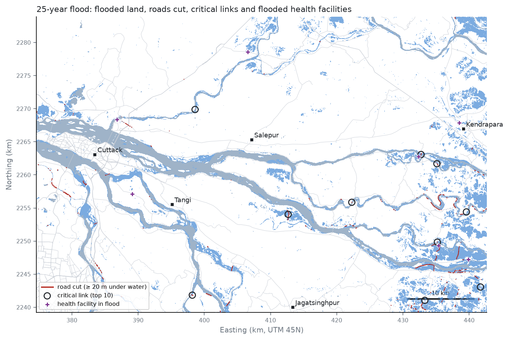

**Why it matters.** A flooded road is a lost hospital trip, a blocked evacuation and a long detour to market.
**What we did.** The OpenStreetMap road network became a graph; flooded sections were cut and shortest paths to
hospitals, towns and dry schools compared with dry weather. **What we found.** In the 25-year flood
52,423 people in 41 settlements lose road access to
any hospital, 20,605 more reach one only by a detour, and everyday trips grow
by about 10,077 person-hours a day. Ten critical links carry most of the cut-off routes (C.2). **At the site:** road
closures at those links.

### 7.3 Structural

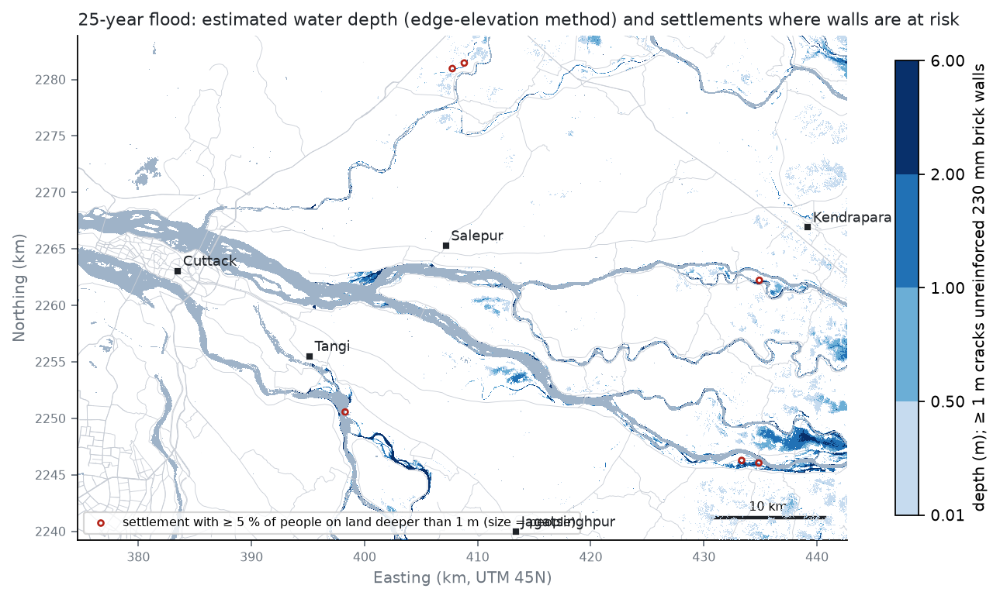

**Why it matters.** Standing water pushes over brick walls, and scour undermines bridge piers. **What we did.** Flood
depth from the ground elevation at the flood edge; a bending check of unreinforced brick walls; IRC:78 scour at
11 major bridges. **What we found.** A 230 mm brick wall cracks at about
0.8–1.0 m of water, and
4,080 people live where the 25-year flood is a metre deep or more. Pier scour reaches
7–24 m below the high flood
level if a branch carries a quarter of the 100-year flow; how the flow splits between branches is the missing input.
**At the site:** flood marks, deck clearance and foundation levels.

### 7.4 Geotechnical: river banks

**Why it matters.** Embankment breaches cause the worst local floods. **What we did.** 664 one-kilometre
bank cells were ranked by how often water stands behind the bank, in how many years, how erodible the soil is and how
many people live nearby. **What we found.** Twenty inspection sites at least 3 km apart (map and list in C.4);
SoilGrids at 250 m cannot tell one bank from another, so the field samples and lab tests decide. **At the site:** bank
inspection, slopes and soil samples.

### 7.5 Geotechnical: ground under houses that stay dry

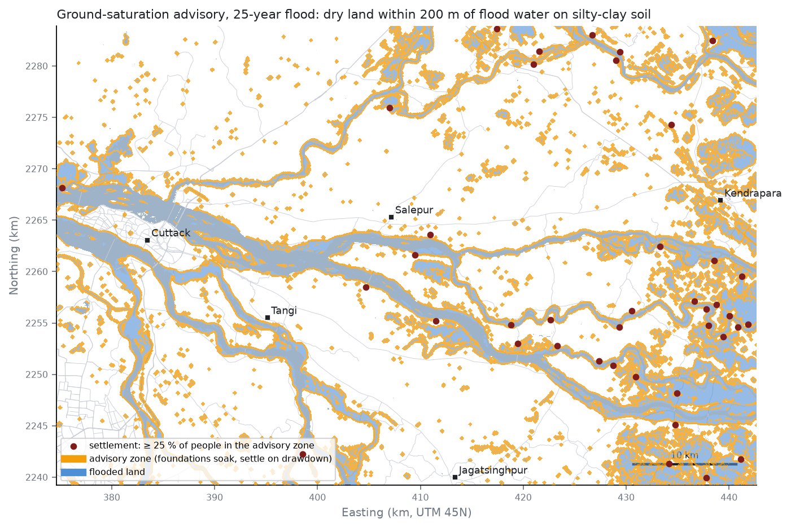

**Why it matters.** Floodwater raises the groundwater under dry houses nearby: foundations weaken while it is high and
settle when it drops. **What we did.** An advisory zone of dry land within 200 m of flood water on fine-grained soil,
with textbook bearing-capacity and settlement checks. **What we found.** 441,605 people
(329 settlements) live in the zone in the 25-year flood; soaking cuts the bearing
capacity of a strip footing on silty sand by about 55 %, and a 2 m
drop of the water table settles soft clay by 20 to 39 mm.
**At the site:** water levels in village wells at 0–500 m from the flood edge.

### 7.6 Ocean

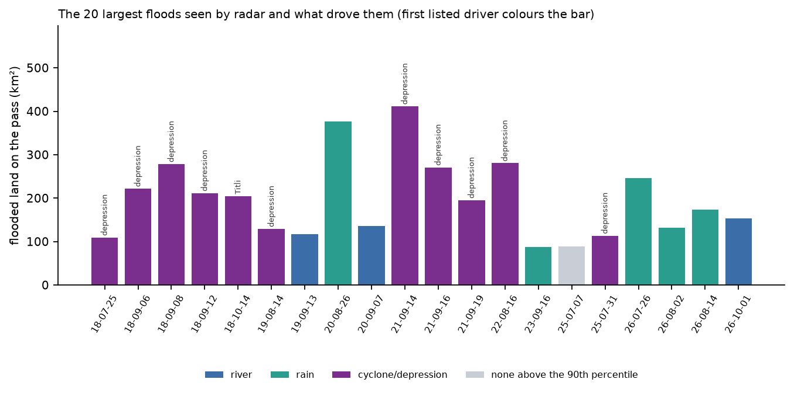

**Why it matters.** Bay of Bengal cyclones and depressions bring the heaviest rain, and surge and tide hold back the
drainage of the lower delta. **What we did.** IBTrACS storm tracks were matched to the radar floods. **What we found.**
37 systems passed within 300 km since 2016; of the 20 largest floods,
11 followed one, 13 came with heavy rain and 15 with a high river.
**At the site:** interviews on surge and tide-locked drainage.

### 7.7 Construction technology and management

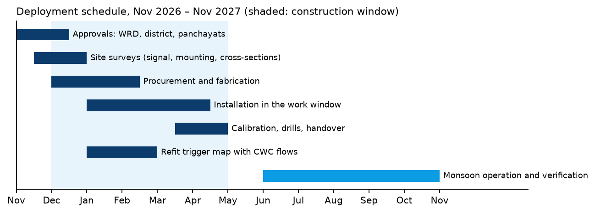

**Why it matters.** Protection and sensors must be built outside the flood season, in the right order and within a
budget. **What we did.** Monthly flood and storm climatology, an earthwork take-off for raising the critical links,
deployment quantities and a schedule. **What we found.** The work window is December–April. Raising 10
critical links takes about 27,603 m³ of earthwork (about ₹0.97 crore
at an assumed ₹350/m³); none needs more than 2.1 m, so all are road embankments and none needs a bridge or a vented causeway. Installing 40 sirens and 6 river gauges takes about
78 crew-days. **At the site:** access, mounting and signal at the proposed sites.

### 7.8 Water resources and the watershed

**Why it matters.** The delta's floods are set upstream, by releases from Hirakud dam and by rain on the uncontrolled
tributaries below it, so a warning for the delta is a warning about the whole watershed. **What we did.** GloFAS
flows below Hirakud, at Tikarpara and at Naraj (1997–2025) were compared at the annual flood peak and over the monsoon
(C.8), next to the travel times and design floods of §6.5. **What we found.** Hirakud controls about 59 % of the basin
(83,400 of about 141,600 km²) and passes 60% of the July–September flow at Naraj, but only a median
48% of the annual flood peak (29 years): the other half comes from the
roughly 58,000 km² below the dam, within about a day. A delta warning therefore needs both the dam's release plan and
gauges on the tributaries below it, and watershed measures in that lower catchment (land cover, soil conservation, small
storages) act on the frequent floods more than on the rare largest ones. **At the site:** discharge and Manning's n at a
road bridge; the WRD's account of gate operations.

### 7.9 Flood risk in rupees and person-days

**Why it matters.** Protection and warnings compete for money with everything else a district builds, so the hazard
has to be put in rupees and in days of life disrupted. **What we did.** Flood depth (§7.3) times the JRC depth–damage
curve for houses in Asia gives the houses damaged; flooded paddy at Odisha's yield and the support price gives the crop
lost; every day of 1997–2025 (29 years) at Naraj, run through the flow–impact table, gives what an average year costs (C.9).
**What we found.** Expected flood damage is about ₹17 crore a year (houses ₹4.2
crore, paddy ₹12.9 crore), a lower bound because floods above the largest seen are. An average year
brings 438,978 person-days on flooded land and 131,511
person-days without road access to any hospital. Raising the ten critical links (§7.7) cuts the latter to
54,811; valued only at the rural wage, that repays the earthwork
17 times. Every 1,000 m³/s that Hirakud keeps off a 5-year peak keeps about 1,535
people dry. The impact-based warning levels of §9.7 would have reached "Be prepared" on 3.8
days a year on average, so warnings stay rare. **At the site:** the farmers' and householders' losses in the interviews.

## 8. Field visit: what we measure, whom we ask, and what it changes

The 14 October review was explicit: the committee will ask what we did at the site, what we took from it and how
it changed the work. The visit is therefore designed around **the gaps the models cannot close by themselves**.
The full protocols, equipment and safety rules are in `fieldkit/FIELD_VISIT_KIT.md`; the data sheets are the CSV
files in `fieldkit/templates/`; every sheet has an analysis script in `fieldkit/analysis/`, tested on made-up
example sheets (`fieldkit/examples/`, marked EXAMPLE, never reported as results).

> **Status (30 Oct 2026):** visit being arranged with Prof. Basudev Biswal (Mahanadi basin project) and ClimMaTech.
> Sections 8.3–8.7 are filled in from the field sheets after the visit; until then they state the method only.

### 8.1 Where and with whom

Planned area: the Mahanadi delta between Naraj (delta head, CWC gauge, Naraj and Mundali barrages) and
Kendrapara. Hosts and interviews: Odisha Water Resources Department (Mahanadi divisions, Cuttack), CWC Mahanadi
division, the district emergency office, ClimMaTech, and residents at the check points. Data requested before
the visit: daily discharge at Naraj/Mundali 2017–2025, embankment inventory and breach history, villages
evacuated in 2020 and 2022, NDEM flood layers for August 2020 and 2022.

### 8.2 Check points carried to the field

`fieldkit/checkpoints/checkpoints.gpx` (phone GPS) and `.kml` (Google Earth), generated from the atlas and
impact results by `mahanadi/make_checkpoints.py`:

| Code | Number | What | Chosen how |
|---|---|---|---|
| GT | 40 | Ground-truth points | Random, 10 in each atlas class (never / < 10 % / 10–30 % / ≥ 30 % of passes flooded), within 150 m of a road and 1 km of a settlement, ≥ 2 km apart |
| SR | 15 | Siren sites | Top of the greedy coverage list (§9) |
| RS | 6 | River-sensor bridges | One per main distributary: the bridge nearest Naraj with dry approaches (§9) |
| GB | 12 | Bank inspection and soil sampling | Top of the geotechnical screening (§7.4) |
| RL | 10 | Critical road links | Flooded links carrying most people's hospital route (§7.2) |
| HF | ≤ 10 | Health facilities flooded in the 25-year flood | §7.1 |
| WL | 8 | Well water levels | Settlements in the ground-saturation advisory list (§7.5) |

Random ground-truth points matter: checking the map only where it is easy to reach, or only where it shows
water, would overstate its accuracy.

### 8.3 Atlas accuracy at the ground-truth points  *(to be filled after the visit)*

Method: `fieldkit/analysis/field_validate_map.py`. Each (point, year) pair with a local answer is one test:
hit, miss, false alarm or correct negative, with a 60 m window for GPS error. Report POD, FAR and CSI, the
flood-mark heights, and the cases where people and the atlas disagree, with the likely reason (short floods
between radar passes, flooded paddy, water under tree cover, memory of the wrong year).

*What it changes:* the accuracy statement that goes with the map to ClimMaTech; if misses cluster in short
floods, the atlas needs the denser 6-day revisit of Sentinel-1C/D; if false alarms cluster on paddy, the
river-driven mask (§6.3) must be applied before warnings. The flood-mark heights are compared with the DEM-based
depth (§7.3): the wall screening and the road-raising earthwork (§7.7) scale with that depth.

### 8.4 Discharge and roughness at a bridge  *(to be filled after the visit)*

Method: cross-section from the bridge and float timings, velocity-area method (ISO 748 mid-section,
surface-to-mean factor 0.85 with 0.80–0.90 as the range), water-surface slope over 200–500 m;
`discharge_velocity_area.py` and `manning_cowan.py`.

*What it changes:* (1) measured flow vs GloFAS for that day, a first check of the modelled discharge that drives
§6; (2) Manning's n from slope and discharge and from Cowan's method vs the n = 0.015 that the PINN assumes
(§5): the Saint-Venant case is re-run with the measured n; (3) if a ClimMaTech or CWC radar gauge is on the
bridge, our float discharge against its level and surface-velocity reading.

### 8.5 Bridges and roads  *(to be filled after the visit)*

Method: deck-to-water, deck thickness, high-flood-level marks, scour and debris, closure history;
`bridge_clearance.py` checks the clearance above HFL against IRC:5 (1.5 m for Q > 3,000 m³/s). At the critical
links: was the road closed in 2020/2022, for how long, which detour was used.

*What it changes:* confirmed closures validate the network model; a road the model calls safe but locals
report cut (or the reverse) re-ranks the critical links of §7.2; bridges with insufficient clearance or scour
are added to the structural list.

### 8.6 River banks and soils  *(to be filled after the visit)*

Method: bank geometry, seepage and boils, cracks, burrows, breach history; two samples per GB site; in the
IITB geotechnical laboratory wet sieving (IS 2720 Part 4) and liquid/plastic limits (IS 2720 Part 5);
`soil_gradation.py` gives the IS 1498 and USCS class, Cu, Cc, PI, the Kenney–Lau internal-stability check and a
piping-susceptibility flag.

*What it changes:* measured classes replace the SoilGrids texture in the bank-screening ranking (§7.4); cells
with non-plastic silty sand and recurrent water behind the bank move to the top of the inspection list.

### 8.7 Sensor and siren sites, and the interviews  *(to be filled after the visit)*

Method: structure, mounting height, view of the channel, mobile signal (dBm), sun hours, access in a flood,
security, permissions; interview notes in `interviews.csv`.

*What it changes:* sites without signal or without flood-time access are dropped from the deployment plan (§9);
the engineers' rule of thumb for "which flow at Naraj floods which villages" is compared with the trigger-
discharge map (§6.3) and with the levels of the live warning (§9.7); the house and paddy losses people report for 2020
and 2022 check the damage estimate (§7.9); the constraints heard in the interviews are written into the problem
statement (§1.1).

### 8.8 Groundwater beside the flood  *(to be filled after the visit)*

Method: water levels in 8–12 village wells at roughly 0–50, 50–100, 100–200 and 200–500 m from land that floods,
with the residents' account of how high the wells rose in the last flood and whether houses cracked or settled after
it (protocol H, `templates/well_levels.csv`).

*What it changes:* the 200 m distance of the ground-saturation advisory (§7.5) is replaced by the distance at which
the wells stop responding to the flood; reported cracking after floods tests the drawdown-settlement explanation.

## 9. Implementation for ClimMaTech: what a deployment would use

### 9.1 Where it fits

ClimMaTech's system observes (radar gauges), predicts (level and flow 30 min to 48 h ahead) and warns (sirens,
Aagah app, control centre). This project adds the step between "predict" and "warn": **forecast flow at Naraj →
flooded land → settlements, roads and facilities affected**, from the trigger-discharge map of §6.3 and the impact
layers of §7.

```
ClimMaTech / CWC forecast of Naraj flow ──► forecast_to_impact.py ──► flood map (GeoTIFF)
   (m³/s or lakh cusec, lead time)            trigger map + impacts    settlements to warn (GeoJSON) ──► Rakshak Control Centre, Aagah
                                                                       roads under water, bulletin text ──► district / OSDMA
Sentinel-1 pass (every 2-6 days) ──► atlas_infer.py ──► observed flood map ──► refit trigger map each season
GloFAS ensemble + ECMWF rain + SACHET/CWC alerts ──► live/run_live.py (daily) ──► impact-based level, villages with dates,
                                                                                  CAP alert + Atom feed ──► Rakshak Control Centre
```

### 9.2 Forecast-to-bulletin tool

`python mahanadi/forecast_to_impact.py --q <flow>` (or `--lakh-cusec`, and `--rain <mm>` for the flow-and-rain
analogs) runs in seconds. Output for the 5-year flow (23,940 m³/s; the 25-year and rain bulletins are in
`results/impact/bulletins/`):

```
MAHANADI DELTA - EXPECTED FLOODING FOR A NARAJ FLOW OF 23,940 m3/s (8.5 lakh cusec), lead time 24 h
(flow = highest daily flow over 3 days at Naraj, the measure the atlas is fitted on; method: trigger-discharge map, river flow only)
Expected flooded land: 218 km2
People living on that land: 25,384
Settlements with at least 10 % of people on flooded land: 24
  - near Biridi (1.4 km): about 403 people (70% of 574) at 20.3319 N, 86.0429 E
  - near Patkura (9.7 km): about 341 people (48% of 704) at 20.3133 N, 86.3615 E
  - near Bhattasagar Square (7.0 km): about 263 people (16% of 1,613) at 20.6301 N, 86.1248 E
  - near Choudwar (4.0 km): about 143 people (21% of 694) at 20.5588 N, 85.8918 E
  - near Patkura (2.7 km): about 129 people (20% of 647) at 20.4002 N, 86.3823 E
  - near Patkura (1.5 km): about 90 people (32% of 281) at 20.3855 N, 86.3917 E
  - near Fakirabad (7.2 km): about 89 people (13% of 706) at 20.4445 N, 86.4497 E
  - near Dhuria (8.6 km): about 76 people (14% of 529) at 20.4610 N, 86.3444 E
  - near Patkura (9.3 km): about 75 people (28% of 269) at 20.3113 N, 86.3760 E
  - near Patkura (9.1 km): about 74 people (30% of 253) at 20.3116 N, 86.4309 E
  - near Gobindpur (2.6 km): about 72 people (28% of 260) at 20.3515 N, 86.0166 E
  - near Biridi (7.9 km): about 69 people (14% of 481) at 20.2658 N, 86.0652 E
  - near Bhattasagar Square (5.9 km): about 69 people (17% of 417) at 20.6256 N, 86.1147 E
  - near Patkura (10.8 km): about 67 people (27% of 247) at 20.3116 N, 86.3447 E
  - near Nemalo (1.2 km): about 65 people (16% of 414) at 20.4409 N, 86.1674 E
Main roads under water: 11.4 km; named sections: Right Puri Main Canal Road 0.8 km
Source: Sentinel-1 flood atlas 2017-2026 + GloFAS discharge (IIT Bombay IDP prototype). Not an official warning.
```

The interactive viewer (`dashboard/index.html`, one file, works offline) shows each design flood with flooded land,
roads cut, the settlements list (click to zoom), siren and sensor sites and the bank-inspection cells.

### 9.3 Siren sites

Greedy maximal coverage of the 32,388 people living on land flooded in the 25-year flood or in at
least 10 % of monsoon passes. With 40 sirens the share covered is 32%, 48%
and 62% for an audible range of 1.0, 1.5 and 2.0 km. At 1.5 km: 10 sirens cover 24%,
20 cover 35%. Exposed people are spread thinly over many
small settlements, so the first sirens give most of the benefit; the rest is better reached by phone alerts (Aagah)
than by more sirens.

| Rank | Settlement | Location | New people covered | Cumulative share |
|---|---|---|---|---|
| 1 | Fakirabad | 20.5029 N, 86.4186 E | 1,794 | 6% |
| 2 | near Patkura (8.5 km) | 20.3190 N, 86.3756 E | 1,160 | 9% |
| 3 | near Gobindpur (1.1 km) | 20.3312 N, 86.0318 E | 787 | 12% |
| 4 | near Patkura (1.5 km) | 20.3872 N, 86.4195 E | 760 | 14% |
| 5 | near Bhattasagar Square (7.0 km) | 20.6301 N, 86.1248 E | 669 | 16% |
| 6 | near Balachandrapur (1.4 km) | 20.6305 N, 86.2469 E | 555 | 18% |
| 7 | near Patkura (2.4 km) | 20.4047 N, 86.3886 E | 554 | 19% |
| 8 | near Balachandrapur (3.8 km) | 20.6377 N, 86.2729 E | 505 | 21% |
| 9 | near Fakirabad (6.7 km) | 20.4514 N, 86.3849 E | 497 | 22% |
| 10 | near Patkura (5.9 km) | 20.3416 N, 86.3819 E | 493 | 24% |
| 11 | Jagatpur | 20.4950 N, 85.9355 E | 487 | 26% |
| 12 | near Balachandrapur (2.3 km) | 20.6314 N, 86.2243 E | 456 | 27% |
| 13 | near Patkura (8.6 km) | 20.3448 N, 86.3385 E | 392 | 28% |
| 14 | near Patkura (2.2 km) | 20.4084 N, 86.4129 E | 387 | 29% |
| 15 | near Patkura (3.9 km) | 20.3910 N, 86.4426 E | 367 | 30% |

### 9.4 River-sensor bridges

One non-contact radar gauge (level and surface velocity) at the head of each main distributary measures how the
flood splits between the branches, which the Naraj forecast alone cannot tell:

| River | Bridge | Road class | Length (m) | km from Naraj | Approaches dry in 25-yr flood | Location |
|---|---|---|---|---|---|---|
| Devi River | Netaji Subhash Chandra Bose Setu | primary | 2823 | 8 | yes | 20.4546 N, 85.8481 E |
| Kathajodi | NH16 | trunk | 869 | 13 | yes | 20.4405 N, 85.8901 E |
| Birupa | NH16;NH55 | trunk | 543 | 17 | yes | 20.5133 N, 85.9320 E |
| Luna | (unnamed) | unclassified | 776 | 31 | no | 20.4650 N, 86.0743 E |
| Mahanadi | (unnamed) | unclassified | 458 | 52 | yes | 20.3668 N, 86.2642 E |
| Biropa | (unnamed) | unclassified | 424 | 60 | no | 20.6261 N, 86.3224 E |

Pravaah needs a surveyed cross-section and a surface-to-mean velocity factor to give discharge (ClimMaTech
documentation); the field protocol B–C measures exactly these at one bridge (§8.4).

### 9.5 Rolling it out

1. **Season 0 (now)**: hand the trigger map, bulletin tool, live feed and viewer to ClimMaTech; run the live feed every
   morning; refit with CWC/WRD observed flows.
2. **Before the next monsoon**: field-verified siren and sensor sites (§8.7); first sensors at the heads of the
   Mahanadi and Kathajodi branches.
3. **During the monsoon**: map every new Sentinel-1 pass (6 s per pass on the lab GPU, ~2 min to download) and compare
   with the bulletin of that day; add the season to the atlas.
4. **Each year**: refit the trigger map, update design floods, re-rank links and banks.

### 9.6 Gaps in the partner's services and what this project adds

All 50 public pages of climmatech.com were downloaded on 29 October 2026; the product, solution, platform, fact-sheet
and case-study pages were read in full and the blog was searched. The partner measures and forecasts the river at points and warns through sirens and an app; its
research group reconstructs past floods from satellite, seismic and gauge data by hand. The table lists each service, the
gap found and what this project adds, with the number behind it.

| Their service | Gap | What this project adds | Evidence |
|---|---|---|---|
| River View (platform layer: "a live map-based view of river levels and flood risk") | No flood-extent layer behind the map | Flood frequency, trigger flow and impact layers for the Mahanadi delta | 590 passes; held-out IoU 0.20 vs 0.04 at high flows |
| AI forecasting, 30 min to 48 h ahead | A forecast level is not a list of villages | Forecast-to-bulletin tool and a daily live feed with impact-based levels; a 1–3 day Naraj forecast from upstream flows (§6.7, §9.7) | 25-year flow: 240 km², 30,427 people, 32 settlements; forecast efficiency 0.99 / 0.94 / 0.89 at 1 / 2 / 3 days |
| Research group, satellite reconstructions | Flood width measured by hand at 36 cross-sections; optical pass 75–79 % cloud, only radar pass two days early | Benchmarked radar model that maps every Sentinel-1 pass automatically, through cloud | 92 audited runs (Appendix A); ~5 s per pass |
| Solution pages, network design | Layouts drawn as illustrations | Data-backed siting of sirens and river gauges with coordinates | 40 sirens reach 48% of exposed people at 1.5 km; 6 sensor bridges |
| Pravaah discharge | Needs a surveyed cross-section and a surface-to-mean velocity factor | Field protocols B and C measure both, plus Manning's n | §8.4; scripts in `fieldkit/analysis/` |
| Varshaq rain gauge | Rain not linked to flooded land | Rain-aware flood maps (analogs, learned model §6.6) | 5-year flow: 27 km² dry week vs 93 km² heavy rain |
| Flood-warning solution and Aagah app ("time to evacuate populations, reroute traffic, and secure critical infrastructure") | Which people, which roads | Settlements to warn, roads that close, villages that lose their hospital, in every bulletin | 41 settlements lose hospital access (25-year flood) |
| Rakshak Control Centre ("draw an area, pick districts, or upload your own boundaries"; accepts CAP) | Alert areas drawn by hand | Every forecast also writes a CAP 1.2 alert with one area per settlement to warn, listed in an Atom feed the centre can subscribe to | `bulletin_<flow>.cap.xml`; 32 areas for the 25-year flow |
| Dam and reservoir solution | Level at the dam, not the water spread | The same radar model can map reservoir area on every pass (next step: Hirakud) | — |
| Installation and O&M | Timing against floods and storms | Work window and schedule from 29 years of flows and 46 years of storm tracks | December–April; 78 crew-days |

### 9.7 The live warning service

The bulletin tool of §9.2 needs someone to type a flow. The live service (`live/`) reads the forecasts itself, every
time it runs, from sources that need no login, each a plugin that fails soft (`live/sources.py`):

| Plugin | Source | What it gives |
|---|---|---|
| glofas | GloFAS v4 through the Open-Meteo flood API | the Naraj flow 30 days ahead: control run and 50 ensemble members; the upstream gauges |
| rain | ECMWF IFS 0.25° through the Open-Meteo forecast API | daily rain over the delta and over the catchment, 16 days ahead |
| sachet | NDMA SACHET CAP feed of the state | official IMD, CWC and SDMA alerts, matched to the basin's districts |
| cwc | CWC flood-forecasting portal | stations now above warning level (answers from Indian networks) |
| sentinel1 | Planetary Computer catalogue | the latest radar pass over the basin, to map the flood actually there |

For each of the 51 runs and each day the flow measure the atlas uses (the 3-day peak at Naraj) is looked up in the
flow–impact table that `mahanadi/impact_curve.py` sweeps once from the trigger map: flooded land, people on it, villages
with 10 % of their people on flooded land, people cut off from every hospital, and per village the flow at which that
happens (the sweep reproduces the design-flood numbers of §7 exactly). The warning level is set by impact, as in
impact-based forecasting: "Be aware" from 5,000 people on flooded land or three villages (12,250 m³/s at Naraj),
"Be prepared" from 10,000 people or the first village cut off from every hospital (18,500 m³/s), "Act now" from
25,000 people or 20,000 cut off (21,250 m³/s), each with the share of the 51 runs that reach it. Villages,
hospital cut-offs, roads and health facilities count beyond the ordinary monsoon: what is already wet or cut at the flow
exceeded on a quarter of monsoon days (6,682 m³/s at Naraj) belongs to the season, not to a
flood. A few river-bank hamlets get wet every monsoon, and on the Brahmani a road without a mapped bridge cuts six
villages off at almost any monsoon flow: a road to raise, not a warning. The output
is a bulletin naming each village with the first day it is expected (median run) or possible (wettest runs), the
villages that lose their hospital, the roads that close and the health facilities at risk; a CAP 1.2 alert (status
"Exercise") from "Be aware" upwards; an Atom index of the alerts, the way CAP feeds are published, for the Rakshak
Control Centre to subscribe to; and a status board. A run takes about 15 seconds on a laptop; on the lab server
`server/run_live.sh` is ready to run every morning from one cron line (README).

The run of 2026-10-31 01:58 IST: Naraj 2,923 m³/s, peaking near 3,810 m³/s
on 2026-11-01 (wettest runs 3,836), level "No flood impact"; the upstream-gauge model of §6.7 gave 2026-10-31 2,526, 2026-11-01 3,078, 2026-11-02 2,762 m³/s for the next three days. The state feed carried
10 official alerts, among them: Moderate Rain, Thundershower with wind speed 30-40kmph is very likely to occur at many places over Anugul, Baleshwar, Bhadrak, Cuttack, Dhenkanal, …; Moderate Rain with squally wind 30-40 kmph  is very likely to occur at isolated places over Baleshwar, Bhadrak, Cuttack(Including Cuttack City), ….

Every basin of §6.8 runs in the same feed with its own tables and the same rule (`live/basins/<basin>.json`, written by
`live/make_basin_config.py`). The flows at which each level starts, and the run of 2026-10-31:

| Basin | Gauge (flow measure) | Ordinary monsoon (m³/s) | Be aware from (m³/s) | Be prepared from | Act now from | Flow today | Level today |
|---|---|---|---|---|---|---|---|
| Mahanadi delta | Naraj (3-day peak) | 6,682 | 12,250 | 18,500 | 21,250 | 2,923 | No flood impact |
| Brahmani–Baitarani delta | Jenapur (same-day flow) | 1,737 | 3,500 | 3,500 | 4,250 | 442 | No flood impact |
| Brahmaputra at Majuli | Neamatighat (3-day peak) | 17,988 | 21,500 | 22,750 | 29,000 | 2,971 | No flood impact |

On the Brahmani the first village cut off from every hospital comes at the same flow as the first 5,000 people on
flooded land, so "Be aware" and "Be prepared" start together; on the Brahmaputra "Act now" starts near the 2-year flood
(29,833 m³/s), as
it should on a river island that floods most years.

**Replay of the largest flood of the radar era.** `python live/run_live.py --replay 2022-08-14` runs the
feed as it would have run on the morning of 2022-08-14, with the flows that came as a perfect forecast:
level "Act now" for a Naraj peak of 28,378 m³/s on 2022-08-18, 31 villages named with
the day the water reaches them, and 41 villages that lose road access to every hospital from 2022-08-16.
The upstream-gauge model of §6.7, trained without 2022, forecast 16,254 m³/s for 2022-08-15, 20,554 m³/s for 2022-08-16, 21,327 m³/s for 2022-08-17: lower than the flows that came (a steep rise is the hardest case), but already above the 'Act now' flow three days ahead.
The radar passes of the following days, against the flooded land the bulletin expected at their flow:

| Radar pass | Naraj flow (m³/s) | Box imaged | Flooded land expected (km²) | Seen by radar (km²) |
|---|---|---|---|---|
| 2022-08-16 | 24,603 | 71% | 218 | 280 |
| 2022-08-18 | 28,378 | 100% | 240 | 125 |
| 2022-08-21 | 26,914 | 90% | 228 | 67 |

More land was under water on the first pass, after 177 mm of rain in a week, than at the river crest two days later,
when the rain water had drained: the flow-only map is too small before the crest and too large after it. This is the
case for the rain-aware model of §6.6 in the feed, and for mapping each new radar pass as soon as it arrives.

## 10. Discussion, limitations and conclusions

### 10.1 What the benchmark means for practice

Foundation models did not beat a U-Net on Sen1Floods11, also not on an unseen Indian flood nor with few labels.
The pre-trained features are good (frozen encoders reach 0.62–0.83), but water is a spectrally easy target and a
few hundred labelled chips are enough for a small network. Their value in this project is different: TerraMind takes
radar alone as a native input, which is what remains during a monsoon flood. Fusion helped only when its members
made different errors (U-Net + CNN + the best foundation model).

### 10.2 What the Mahanadi work adds

The atlas turns a free, global archive into a local hazard layer: which land floods, how often, and at which river
flow. The trigger-discharge map is the piece a point-forecast system lacks, and it was tested the way it would be
used: predicting a year it had not seen, from discharge alone. The impact analyses put the map into civil-engineering
terms — hospitals cut off, critical links, banks to inspect, siren and sensor sites — with coordinates that can be
checked in the field. The flow forecast and the live feed turn the map into a daily service that names villages and
dates, and the risk estimate puts the hazard in rupees and person-days, the terms in which protection is funded.

### 10.3 Limitations

- One Indian test event (Assam 2016) in the benchmark; the NDEM-based Indian chips of the mid-term were not on
  the lab server.
- No surveyed flood maps for the Mahanadi; the atlas is checked against Sentinel-2 and, after the visit, against
  random field points.
- Modelled discharge (GloFAS) and modelled population (GHSL); OpenStreetMap is incomplete in villages.
- Radar-only water maps: about 0.65 IoU on the benchmark; urban and vegetated flooding are under-detected.
- The road model treats any 20 m of water as a closure and ignores depth; the bank screening uses 250 m soil data.
- Pass-level prediction is modest (pixel IoU ~0.2, settlement POD well below half): floodplain flooding is patchy, the
  observed maps are themselves radar maps, and local rain and storms — not only the Naraj flow — drive the largest
  floods. Past flood frequency ranks where land floods best (ROC AUC 0.90–0.91);
  the trigger map adds at which flow it floods (AUC 0.72), so the two are used together.
- Flood depth comes from a 30 m surface model (~2 m vertical error); wall screening, scour and foundation numbers
  use typical parameters (masonry tension, bed size, soil strength) and an unknown flow split between distributaries,
  all of which the field visit and the lab replace.
- The money figures use a continental depth–damage curve, the public housing grant as the value of a house, an
  assumed 4.4 people per household and a simple paddy-loss rule; they are lower bounds to be checked against the
  losses people report (§8.7).
- The live warning levels are proposed thresholds; GloFAS's own forecast skill at Naraj and the flow forecast of §6.7
  have not been checked against measured flows.

### 10.4 Conclusions

1. On a flood it had never seen, a U-Net (0.770) mapped water better than six geospatial
   foundation models (best 0.747); a three-model fusion was best
   (0.776).
2. A radar-only fusion of TerraMind and U-Net maps the Mahanadi delta through monsoon cloud; 590 passes
   from 2017 to 2026 form the atlas.
3. A per-pixel trigger discharge turns a Naraj flow forecast into a flood map and beats climatology on held-out years
   at high flows (0.20 vs 0.04).
4. In a 25-year flood about 30,427 people live on flooded land and 52,423 lose
   road access to a hospital; the links, banks, siren sites and sensor bridges to act on are listed.
5. Local rain and Bay of Bengal storms, not only the river, drive the largest floods of the delta; a warning has to
   read the river forecast together with the rainfall forecast. A learned model that adds rain and each pixel's flood
   history to the flow maps held-out heavy-rain passes better than the trigger map
   (0.22 vs 0.15).
6. The same scenarios give each specialization its answer: who loses the road to a hospital or shelter
   (transportation), where walls crack and how deep scour reaches (structural), which banks to inspect and which dry
   houses sit on soaked ground (geotechnical), how storms add to floods (ocean), when and at what earthwork the
   critical links can be raised (construction management), and where a flood peak comes from: about half from
   Hirakud dam and half from the tributaries below it (water resources).
7. Every one of the 92 training runs was re-checked from its saved outputs and the published TerraMind scores were
   reproduced within a point, so the benchmark can be relied on.
8. The Naraj flow can be forecast one to three days ahead from today's upstream flows and catchment rain (efficiency 0.89 three days ahead against 0.79 for persistence), and a live feed turns each day's GloFAS ensemble into an impact-based warning, a CAP alert and a list of villages and roads with dates.
9. The pipeline is not specific to the Mahanadi: the Brahmani–Baitarani delta and the Brahmaputra at Majuli were mapped from every radar pass since 2017 with the same models and joined the live feed.
10. Flood damage to houses and paddy is at least ₹17 crore a year; raising the ten critical roads repays its cost about 17 times in hospital access alone, so it is the first protection measure to fund.
10. The field visit is designed to measure what these numbers depend on and to change them where they are wrong.
### 10.5 Next steps, by specialization

| Specialization | Next step | Why |
|---|---|---|
| Remote sensing | Add SWOT water-surface elevations (2023–) and NISAR L-band (2025–) | Depth from measured water levels instead of a surface model; flooding under crops and trees |
| Water resources | Refit with observed CWC/WRD flows; calibrate a 2-D HEC-RAS model of the delta against the atlas | A physics-based inundation model that can go beyond the floods seen since 2017 |
| Transportation | Evacuation routing and shelter capacity from the live cut-off dates (§9.7); school and market (mandi) access | Who to move first, and where to |
| Structural | Local depth–damage curves for kutcha and pucca houses from the field survey, replacing the continental JRC curve of §7.9 | A damage estimate fitted to the delta's houses |
| Geotechnical | 2-D seepage analysis of the top-ranked embankments with lab permeability; bank-line migration from Landsat 1990– | Piping and erosion risk with numbers, not ranks |
| Ocean | Paradip tide-gauge and surge hindcasts; sea-level-rise scenarios for drainage of the lower delta | Compound river–rain–surge flooding |
| Construction technology & management | Life-cycle cost and O&M plan of the sensor network; procurement through GeM; contract packaging for road raising | From a plan to a project ClimMaTech and WRD can execute |

The common first step for all of them is the field visit (§8) and the observed Naraj flows.

### 10.6 Abstract for HYDRO 2026 / journal submission

*Turning river-flow forecasts into flood maps with Sentinel-1 and geospatial foundation models: the Mahanadi delta.*
We benchmark six geospatial foundation models against CNN and U-Net baselines on Sen1Floods11 with a leave-India-out
protocol (U-Net 0.770, best foundation model 0.747, fusion
0.776 IoU on an unseen Indian flood), build a radar-only flood atlas of the
Mahanadi delta from 590 Sentinel-1 passes (2017–2026), and link it to river
discharge at Naraj through a per-pixel trigger discharge. On held-out years the resulting flow-to-flood maps reach IoU
0.20 at high flows against 0.04 for flood climatology. Combined with road
networks and population, they identify the people cut off from hospitals, critical road links and river banks for
inspection, giving point-forecast early-warning systems the spatial impact layer they lack. A gradient-boosted model forecasts the Naraj flow one to three days ahead (Nash–Sutcliffe efficiency 0.99–0.89 on unseen monsoons), and a live feed turns each day's GloFAS ensemble into impact-based warnings published as CAP alerts.

## Appendix A. Verification of the training

`scripts/audit_training.py` re-checks every benchmark run on the lab server from its stored outputs
(`results/analysis/audit_training.json`).

| Check | Result |
|---|---|
| Every queued job has results made with the arguments it was queued with | 92 of 92 |
| No chip in two of train / validation / test | yes, every run |
| Leave-India-out: no India chip in training or validation; test = the 68 India chips | yes, every run |
| Model selection on validation only (stored best validation IoU = maximum of the history; test touched once) | yes, every run |
| Test IoU recomputed from the saved probabilities equals the stored value | yes, every run |
| Frozen runs train only the decoder | 5%–26% of the parameters |
| Spread over three seeds (sd of test IoU) | at most 0.017 |
| Problems found | 0 |

**Comparison with published numbers.** On the official Sen1Floods11 test split, mean IoU over water and dry (the
metric of the foundation-model papers) for seed 0:

| Model | Water IoU | Mean IoU (%) | Published mean IoU (%) |
|---|---|---|---|
| TerraMind-B, radar + optical | 0.821 | 89.7 | 90.62 |
| TerraMind-B, radar only | 0.654 | 79.8 | 80.39 |
| Prithvi-EO-2.0-300M | 0.824 | 89.9 | – |
| U-Net (from scratch) | 0.838 | 90.7 | – |

The published values are from the TerraMind paper (Jakubik et al. 2025, arXiv:2504.11171, Table 7; PANGAEA protocol
with a different decoder and schedule), so a gap of about one point is expected; our runs reproduce them.

**The atlas input looks like the training input.** Median radar backscatter (dB) after the gamma0-to-sigma0 conversion
used by `atlas_infer.py`, for 24 random July–October passes of the delta and 60 random Sen1Floods11 training chips:

| Pixels | VV | VH |
|---|---|---|
| Sen1Floods11 training chips, water | -17.9 | -25.8 |
| Mahanadi atlas passes, water | -19.4 | -23.1 |
| Sen1Floods11 training chips, dry | -9.7 | -16.1 |
| Mahanadi atlas passes, dry | -8.7 | -15.2 |

Dry land differs by about 1 dB, and water lies 8–11 dB below dry land in both, so the conversion holds.

**Runs whose best epoch was the last one.** 5 of 92 runs
(lio_cnn_full_s1, lio_unet_full_s0, lio_unet_s2_full_s1, official_clay_frozen_s0, official_terramind_full_s2). The headline U-Net gained 0.002 validation IoU over its last five
epochs (converged); the frozen Clay run and the optical-only U-Net (seed 1) were still improving, so those two scores
may be slightly low. Neither changes a ranking or a conclusion.

## Appendix B. Retraining the radar models at the atlas resolution

The atlas reads Sentinel-1 from the 20 m overviews, and the radar models of §4 were trained at 10 m. Both radar-only
models (TerraMind-B and U-Net, official split, seed 0) were retrained with the radar degraded on the GPU exactly as the
overview is made (2 × 2 average in linear power, bilinear back to 10 m; `floodfm/train.py --s1_res 20`) and scored by
`scripts/test_resolution.py` on the official test split:

| Input to the fusion | 10 m-trained pair | 20 m-trained pair |
|---|---|---|
| Native 10 m radar | 0.664 | 0.607 |
| 20 m overview (the atlas input) | 0.640 | 0.695 |
| 20 m overview, threshold from validation | 0.646 (at 0.30) | 0.681 (at 0.45) |

The 20 m-trained pair is better on the atlas input, so the atlas was rebuilt with it (all 590 passes mapped again,
threshold 0.45); every Mahanadi result in this report comes from the rebuilt atlas. The independent
Sentinel-2 check decided it:

| Atlas built with | Sentinel-2, all water: IoU (precision / recall) | Sentinel-2, flood water: IoU (precision / recall) | Held-out high flow: trigger map vs climatology (IoU) | Villages at high flow: POD / FAR | Land flooded at least once (km²) |
|---|---|---|---|---|---|
| 10 m-trained pair (threshold 0.30) | 0.487 (0.60 / 0.73) | 0.180 (0.51 / 0.22) | 0.225 vs 0.070 | 17% / 65% | 905 |
| 20 m-trained pair (threshold 0.45) | 0.563 (0.75 / 0.69) | 0.196 (0.63 / 0.22) | 0.198 vs 0.038 | 21% / 62% | 1,137 |

The Sentinel-2 check is the like-for-like comparison, because the optical reference is the same for both atlases: the
rebuilt atlas agrees better on all water and on flood water, mainly because it reports less false water (higher
precision). The held-out scores are not like for like, because each atlas is scored against its own observed maps.
The rebuilt atlas sees more flooded land, much of it rain-fed (the flooded share of a pass follows the 7-day rain with
rank correlation 0.51, against 0.38 before), which the river flow alone predicts
less well, so the trigger map's pixel score falls while its lead over climatology and its village-level skill improve. The flow
predictor is chosen by rank correlation and moved from the 5-day peak flow to the
3-day peak flow (rank correlation 0.765 against 0.764, practically a tie), so
66 rather than 85 passes count as high flow. The earlier atlas is kept in
`results/archive_atlas_10m/`.

**Three seeds.** Seeds 1 and 2 of both radar models were trained at 10 m and at 20 m (`server/run_r20_seeds.sh`) and each
pair scored the same way; the threshold is chosen on validation for every pair.

| Seed | 10 m-trained pair, 20 m input | same, threshold from validation | 20 m-trained pair, 20 m input | same, threshold from validation |
|---|---|---|---|---|
| 0 | 0.640 | 0.646 | 0.695 | 0.681 |
| 1 | 0.673 | 0.666 | 0.684 | 0.684 |
| 2 | 0.651 | 0.654 | 0.673 | 0.667 |
| Mean ± sd | 0.655 ± 0.014 | 0.655 ± 0.008 | 0.684 ± 0.009 | 0.677 ± 0.007 |

Training at 20 m wins on every seed, by 0.022 IoU on average with the threshold from validation: the gain is well outside the seed-to-seed spread.

## Appendix C. Engineering details of the seven specializations

Formulas, parameters and full tables behind the short summaries of chapter 7 (C.1–C.7 follow 7.1–7.7; C.8 is the watershed analysis of 7.8).

Population: GHSL 2020 (4,102,130 people in the box, 3,839,001 of them in
1,082 settlements). Roads, bridges, railways, hospitals and schools: OpenStreetMap
(6,383 km of road, 691 bridge segments, 386 hospitals and
clinics, 103 schools). All areas exclude the river bed and normal water.

### C.1 Exposure

| Scenario | Flooded land (km²) | People on flooded land | Settlements ≥ 10 % flooded | Cropland (km²) | Road under water, km (main roads) | Rail (km) | Bridges with flooded approach | Health facilities | Schools |
|---|---|---|---|---|---|---|---|---|---|
| 2-year | 50 | 7,837 | 4 | 24 | 6 (1) | 0.0 | 46 | 4 | 0 |
| 5-year | 218 | 25,384 | 24 | 165 | 34 (11) | 0.3 | 71 | 6 | 0 |
| 10-year | 240 | 30,427 | 32 | 182 | 39 (14) | 0.3 | 79 | 7 | 0 |
| 25-year | 240 | 30,427 | 32 | 182 | 39 (14) | 0.3 | 79 | 7 | 0 |
| 50-year | 240 | 30,427 | 32 | 182 | 39 (14) | 0.3 | 79 | 7 | 0 |
| 100-year | 240 | 30,427 | 32 | 182 | 39 (14) | 0.3 | 79 | 7 | 0 |
| flooded in ≥ 10 % of passes | 54 | 11,801 | 3 | 27 | 20 (7) | 0.1 | 62 | 7 | 2 |
| largest seen (2018-09-08) | 278 | 39,367 | 38 | 231 | 35 (11) | 0.4 | 97 | 8 | 2 |

Most flooded land is cropland; the people exposed live in villages on slightly higher ground at the edge of the
flooded fields, which is why a settlement-level list (viewer, bulletin tool) is more useful to a district officer
than a total. Mapped building footprints are incomplete here (Microsoft: 120,647 footprints for
4.1 million people), so people, not buildings, are counted.

### C.2 Transportation systems


| Scenario | Road cut (km) | Settlements cut off from any hospital/clinic | People cut off | People reaching one only by a detour ≥ 5 min | Median detour (min) | People cut off from any town |
|---|---|---|---|---|---|---|
| 2-year | 8 | 0 | 0 | 802 | 7.5 | 0 |
| 5-year | 48 | 39 | 51,155 | 20,287 | 8.3 | 63,788 |
| 10-year | 54 | 41 | 52,423 | 20,605 | 7.6 | 65,056 |
| 25-year | 54 | 41 | 52,423 | 20,605 | 7.6 | 65,056 |
| 50-year | 54 | 41 | 52,423 | 20,605 | 7.6 | 65,056 |
| 100-year | 54 | 41 | 52,423 | 20,605 | 7.6 | 65,056 |
| flooded in ≥ 10 % of passes | 25 | 1 | 521 | 802 | 7.5 | 521 |
| largest seen (2018-09-08) | 49 | 43 | 49,742 | 32,621 | 11.7 | 95,950 |

Graph: 147,729 nodes, 156,647 edges, 6,383 km; 364 hospital/clinic
nodes and 6 towns; settlements farther than 500 m from the main network are not routed.

- **Evacuation**: schools serve as relief camps. In the 25-year flood 101 of the
  mapped schools stay dry and 65,056 people can reach none of them by
  road. OpenStreetMap maps only about a hundred schools here (every village has one), so travel times to shelters
  need the official OSDMA shelter list; the cut-off count is the robust part.
- **Everyday travel**: with an assumed 0.2 trips per person per day to the nearest town, the detours of the 25-year
  flood add about 10,077 person-hours of travel a day — the cost that does not appear in damage figures.
- **Critical links** (flooded sections carrying the most people's dry-weather route to the nearest hospital; raising
  or protecting these keeps the most people connected; earthwork in C.7):

| Rank | Road | Class | People routed | Flooded length (km) | Location |
|---|---|---|---|---|---|
| 1 | (unnamed) | secondary | 10,930 | 0.83 | 20.2661 N, 86.3614 E |
| 2 | (unnamed) | unclassified | 10,351 | 1.68 | 20.3826 N, 86.1631 E |
| 3 | (unnamed) | unclassified | 9,421 | 0.34 | 20.2716 N, 86.0251 E |
| 4 | (unnamed) | unclassified | 7,657 | 0.14 | 20.3995 N, 86.2551 E |
| 5 | (unnamed) | tertiary | 7,582 | 0.42 | 20.4527 N, 86.3781 E |
| 6 | (unnamed) | tertiary | 7,045 | 0.14 | 20.3455 N, 86.3792 E |
| 7 | (unnamed) | unclassified | 6,210 | 0.34 | 20.4651 N, 86.3551 E |
| 8 | (unnamed) | residential | 6,171 | 0.03 | 20.2845 N, 86.4417 E |
| 9 | (unnamed) | tertiary | 4,863 | 0.16 | 20.3869 N, 86.4210 E |
| 10 | (unnamed) | unclassified | 4,638 | 0.05 | 20.5250 N, 86.0275 E |

### C.3 Structural


- **Flood depth** (`impact_depth.py`): the water surface of each flood patch is the median elevation of its edge,
  depth = surface − ground (Copernicus GLO-30, ~2 m vertical error: a screening estimate, checked against the flood
  marks of the field points). 25-year flood: median depth 0.0 m,
  90th percentile 1.1 m.
- **Masonry walls**: water on one side of an unreinforced brick wall gives a base moment γ_w d³/6 per metre; the wall
  cracks when this exceeds f_t t²/6. With flexural tension f_t = 0.1–0.2 MPa the critical depth is
  0.81–1.03 m for a 230 mm wall and
  0.51–0.65 m for a 115 mm wall (self-weight
  ignored, conservative). **4,080 people** live where the 25-year flood is 1 m deep
  or more (5,867 at 0.6 m or more); mud walls weaken with soaking at any depth.
  The settlements are listed in `results/impact/wall_risk_settlements.csv`.
- **Bridge scour** (IRC:78, Lacey): d_sm = 1.34 (D_b²/K_sf)^(1/3), D_b = Q / linear waterway, K_sf = 1.76 √d_m
  (d_m = 0.3 mm until the field sieve gives the bed size); maximum scour 2.0 d_sm at piers, 1.27 d_sm at abutments,
  below HFL. The share of the Naraj flow each branch carries is not known here (asked from WRD). For the 100-year flow
  (+10 %) the maximum pier scour is 7–24 m
  below HFL if the branch carries a quarter of it and 11–38 m
  if it carries half. Minor distributaries carry far less than half, so their upper values are not credible; the
  short waterways of the minor-branch bridges drive the large numbers. With half of the flow through each branch:

| River | Bridge | Linear waterway (m) | Q (m³/s) | D_b (m³/s/m) | d_sm (m) | Pier scour below HFL (m) | Abutment scour (m) |
|---|---|---|---|---|---|---|---|
| Devi River | Netaji Subhash Chandra Bose Setu | 2823 | 22,258 | 7.9 | 5.4 | 10.7 | 6.8 |
| Kathajodi | NH16 | 869 | 22,258 | 25.6 | 11.8 | 23.6 | 15.0 |
| Birupa | NH16;NH55 | 543 | 22,258 | 41.0 | 16.1 | 32.3 | 20.5 |
| Luna | (unnamed) | 776 | 22,258 | 28.7 | 12.7 | 25.4 | 16.1 |
| Mahanadi | (unnamed) | 458 | 22,258 | 48.5 | 18.1 | 36.1 | 22.9 |
| Biropa | (unnamed) | 424 | 22,258 | 52.5 | 19.0 | 38.0 | 24.1 |
| – | (unnamed) | 2240 | 22,258 | 9.9 | 6.3 | 12.5 | 8.0 |
| – | (unnamed) | 1935 | 22,258 | 11.5 | 6.9 | 13.8 | 8.8 |
| – | NH16;NH55 | 2253 | 22,258 | 9.9 | 6.2 | 12.5 | 7.9 |
| – | NH16;NH55 | 2260 | 22,258 | 9.8 | 6.2 | 12.5 | 7.9 |
| Mahanadi | Utkal Gourab Madhusudan Bridge | 2580 | 22,258 | 8.6 | 5.7 | 11.4 | 7.2 |

  –: river not matched in OpenStreetMap; these are the parallel road crossings of the Mahanadi just north of Cuttack
  (20.48 N, 85.91 E). Shares of 25 % and 75 % are in
  `bridge_scour.csv`. Pier foundations must reach well below these depths; the PWD
  foundation levels collected at the site close the check.
- **Clearance and facilities**: 79 bridge segments have flood water within 60 m
  of an end; deck clearance above HFL is checked against IRC:5 at the site (§8.5). 7
  hospitals/clinics and 0 schools have flood water within 60 m; 0.3 km of railway is
  under water.

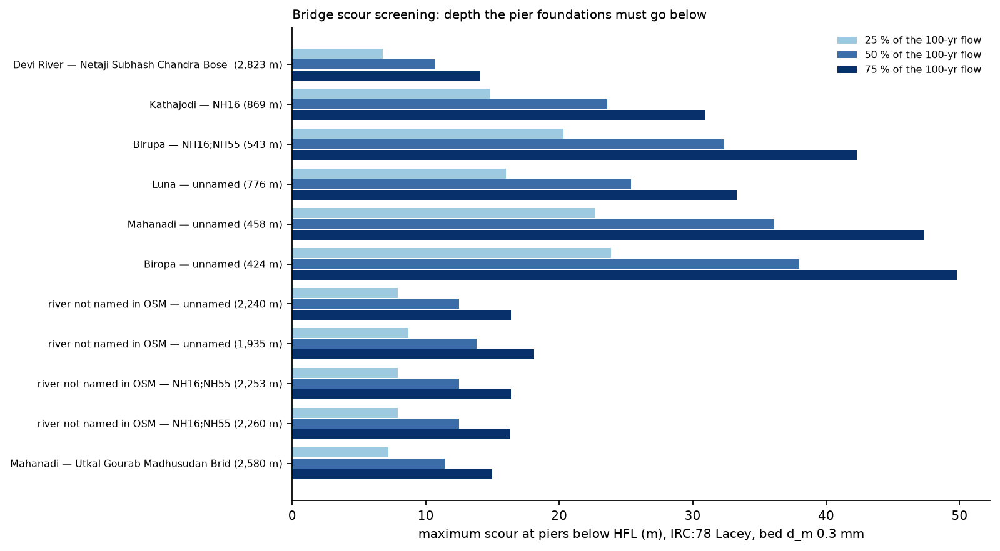

### C.4 Geotechnical: river banks

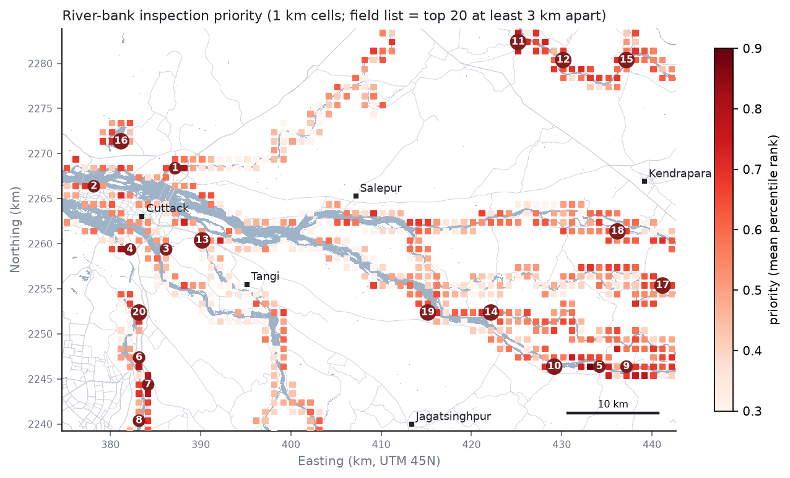

664 one-kilometre cells contain river bank. SoilGrids gives clay loam (454), clay (166), silty clay loam (36), silty clay (8)
— too coarse to tell one bank from another, which is why the field samples matter. OpenStreetMap maps only
12 embankment segments (1.8 km), so the screening works from the river-bed
outline (the WRD embankment inventory is requested in §8.1). The field list is the 20 highest cells at least 3 km apart:

| Rank | Location | Water behind the bank (share of passes) | Years with water behind the bank | Texture (sand/silt/clay %) | People within 2 km |
|---|---|---|---|---|---|
| 1 | 20.5110 N, 85.9180 E | 4% | 10 | clay loam (29/38/32) | 53,829 |
| 2 | 20.4920 N, 85.8320 E | 3% | 10 | clay loam (30/37/33) | 93,127 |
| 3 | 20.4290 N, 85.9090 E | 6% | 10 | clay loam (29/37/34) | 68,934 |
| 4 | 20.4290 N, 85.8710 E | 7% | 10 | clay loam (29/36/34) | 22,047 |
| 5 | 20.3140 N, 86.3690 E | 8% | 10 | clay loam (22/44/34) | 18,481 |
| 6 | 20.3210 N, 85.8810 E | 2% | 10 | clay loam (37/30/33) | 24,225 |
| 7 | 20.2940 N, 85.8910 E | 2% | 9 | clay loam (36/30/34) | 13,872 |
| 8 | 20.2570 N, 85.8810 E | 1% | 8 | clay loam (34/34/32) | 14,397 |
| 9 | 20.3140 N, 86.3980 E | 1% | 8 | clay loam (21/44/34) | 23,281 |
| 10 | 20.3140 N, 86.3220 E | 7% | 10 | clay loam (23/40/37) | 14,275 |

Laboratory plan: wet sieving (IS 2720 Part 4), liquid / plastic limits (IS 2720 Part 5), IS 1498 class, Kenney–Lau
internal stability and a piping flag (`soil_gradation.py`); bank slopes measured at the site give the factor of
safety dry, under seepage and after rapid drawdown (`embankment_stability.py`), when the river falls faster than the
bank drains and the factor of safety roughly halves.

### C.5 Geotechnical: ground saturation under houses that stay dry


Floodwater raises the water table under the land around it. Houses that stay dry but stand on that soaked ground
lose bearing capacity while it is wet and settle when the water table falls back. The advisory zone is dry land within
200 m of flood water on fine-grained soil (silt + clay ≥ 50 %, 94% of the box).

| Scenario | Advisory zone (km²) | People in the zone | People on flooded land | Settlements with ≥ 25 % of people in the zone |
|---|---|---|---|---|
| 5-year | 464 | 407,037 | 25,384 | 305 |
| 25-year | 489 | 441,605 | 30,427 | 329 |
| 100-year | 489 | 441,605 | 30,427 | 329 |
| flooded in ≥ 10 % of passes | 366 | 291,194 | 11,801 | 177 |

What the advisory means for a typical house foundation (strip footing 1 m wide at 1 m depth; textbook parameters to be
replaced by the lab results, `foundation_checks.py`):

- silty sand (φ' = 28°): ultimate bearing capacity 415 kPa with a deep water
  table, 189 kPa with water at the surface
  (−55 %);
- clay loam, undrained: 275 kPa stiff → 172 kPa soaked
  (−37 %);
- when the water table falls 2 m after the flood, 4 m of soft clay consolidates by
  20 to 39 mm (m_v 0.25–0.5 m²/MN) — enough to crack
  load-bearing masonry where it is uneven.

The 200 m distance is a screening value; the water levels in village wells at increasing distance from the flood edge
(field protocol H) fix it.

### C.6 Ocean engineering


37 cyclones and depressions passed within 300 km of the delta since 2016
(IBTrACS). Of the 20 largest floods seen by radar, 15 came with a high Naraj flow (≥ 9,682 m³/s, the
monsoon 90th percentile), 13 with heavy rain (≥ 135 mm in 7 days) and
11 within a week of a Bay of Bengal system:

| Date | Flooded land (km²) | Naraj flow (m³/s) | Rain (mm) | System | Drivers |
|---|---|---|---|---|---|
| 2021-09-14 | 411 | 11,614 | 231 | depression (unnamed) | river + rain + cyclone/depression |
| 2020-08-26 | 377 | 14,487 | 187 |  | river + rain |
| 2022-08-16 | 280 | 24,603 | 177 | depression (unnamed) | river + rain + cyclone/depression |
| 2018-09-06 | 222 | 13,867 | 186 | depression (unnamed) | river + rain + cyclone/depression |
| 2018-09-12 | 212 | 13,645 | 117 | depression (unnamed) | river + cyclone/depression |
| 2026-07-26 | 246 | 5,283 | 259 |  | rain |
| 2018-09-08 | 278 | 15,030 | 159 | depression (unnamed) | river + rain + cyclone/depression |
| 2021-09-16 | 271 | 15,380 | 242 | depression (unnamed) | river + rain + cyclone/depression |
| 2026-08-14 | 174 | 9,682 | 187 |  | river + rain |
| 2021-09-19 | 195 | 12,617 | 175 | depression (unnamed) | river + rain + cyclone/depression |
| 2026-10-01 | 153 | 19,497 | 56 |  | river |
| 2018-10-14 | 205 | 6,901 | 145 | Titli | rain + cyclone/depression |
| 2020-09-07 | 136 | 10,279 | 42 |  | river |
| 2026-08-02 | 132 | 14,893 | 155 |  | river + rain |
| 2019-08-14 | 129 | 8,709 | 74 | depression (unnamed) | cyclone/depression |
| 2019-09-13 | 118 | 18,577 | 59 |  | river |
| 2025-07-31 | 114 | 16,217 | 85 | depression (unnamed) | river + cyclone/depression |
| 2025-07-07 | 88 | 3,854 | 125 |  | none above the 90th percentiles |
| 2023-09-16 | 87 | 7,533 | 156 |  | rain |
| 2018-07-25 | 109 | 12,444 | 271 | depression (unnamed) | river + rain + cyclone/depression |

Systems that came within 300 km:

| System | Closest | Distance (km) | Max wind near the delta (kt) | Rain that week (mm) | Max Naraj flow that week (m³/s) | Largest flood on a pass (km²) |
|---|---|---|---|---|---|---|
| Roanu | 2016-05-20 | 132 | 45 | 102 | 69 |  |
| depression (unnamed) | 2016-08-17 | 259 | 25 | 47 | 10,398 |  |
| depression (unnamed) | 2016-11-05 | 236 | 25 | 79 | 1,212 |  |
| depression (unnamed) | 2017-07-18 | 99 | 25 | 89 | 6,838 | 54.5 |
| depression (unnamed) | 2017-10-19 | 64 | 25 | 152 | 2,611 | 18.2 |
| depression (unnamed) | 2017-11-17 | 107 | 25 | 104 | 2,957 | 4.1 |
| depression (unnamed) | 2017-12-09 | 170 | 30 | 98 | 1,171 |  |
| depression (unnamed) | 2018-07-21 | 192 | 30 | 249 | 12,444 | 109.3 |
| depression (unnamed) | 2018-08-07 | 123 | 25 | 212 | 11,040 | 58.1 |
| depression (unnamed) | 2018-08-15 | 52 | 25 | 103 | 13,365 | 49.8 |
| depression (unnamed) | 2018-09-06 | 155 | 30 | 164 | 15,030 | 278.4 |
| Daye | 2018-09-20 | 178 | 35 | 88 | 5,382 | 54.2 |
| Titli | 2018-10-12 | 82 | 80 | 78 | 6,901 | 204.9 |
| Fani | 2019-05-03 | 28 | 115 | 180 | 1,168 |  |
| depression (unnamed) | 2019-08-07 | 140 | 30 | 133 | 11,428 | 129.2 |
| Bulbul (Matmo) | 2019-11-09 | 154 | 75 | 43 | 1,844 | 14.5 |
| Amphan | 2020-05-20 | 180 | 100 | 112 | 377 |  |
| depression (unnamed) | 2020-10-22 | 147 | 25 | 58 | 3,040 | 23.6 |
| Yaas | 2021-05-26 | 134 | 75 | 149 | 385 |  |
| depression (unnamed) | 2021-09-13 | 64 | 30 | 227 | 15,380 | 411.3 |
| Gulab (Shaheen) | 2021-09-26 | 217 | 45 | 52 | 6,682 | 96.1 |
| Jawad | 2021-12-05 | 105 | 30 | 158 | 1,527 |  |
| depression (unnamed) | 2022-08-09 | 67 | 25 | 193 | 24,603 | 280.4 |
| depression (unnamed) | 2022-08-14 | 184 | 25 | 171 | 28,378 | 280.4 |
| depression (unnamed) | 2022-08-19 | 215 | 30 | 136 | 26,914 | 67.4 |
| depression (unnamed) | 2022-09-11 | 182 | 25 | 74 | 6,294 | 14.0 |
| Hamoon | 2023-10-23 | 254 | 50 | 3 | 2,088 | 9.6 |
| Midhili | 2023-11-16 | 247 | 35 | 25 | 1,261 | 4.7 |
| depression (unnamed) | 2024-07-20 | 112 | 25 | 50 | 4,852 | 16.8 |
| depression (unnamed) | 2024-09-09 | 52 | 30 | 52 | 19,098 | 26.8 |
| depression (unnamed) | 2024-09-15 | 288 | 30 | 77 | 17,946 | 18.6 |
| Dana | 2024-10-26 | 88 | 60 | 70 | 1,874 | 13.3 |
| depression (unnamed) | 2025-05-29 | 230 | 30 | 70 | 558 | 7.1 |
| depression (unnamed) | 2025-07-25 | 273 | 25 | 86 | 16,217 | 113.5 |
| depression (unnamed) | 2025-08-19 | 188 | 20 | 100 | 7,655 | 28.3 |
| depression (unnamed) | 2025-09-26 | 128 | 25 | 68 | 9,682 | 52.1 |
| depression (unnamed) | 2025-10-02 | 181 | 30 | 120 | 11,454 | 15.4 |

Storm surge and high tide also slow the drainage of the lower delta through the tidal distributaries; the study box
ends about 25 km inland of Paradip, and a tide-gauge record (Paradip) is the first ocean dataset to add.

### C.7 Construction technology and management

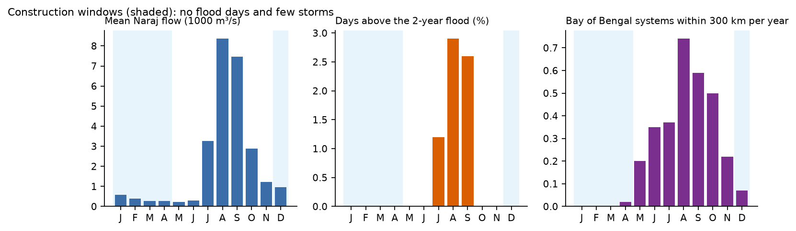

| Month | Mean Naraj flow (m³/s) | Days above the 2-year flood | Storms within 300 km per year | Mean flooded share on radar | Work window |
|---|---|---|---|---|---|
| Jan | 569 | 0.0% | 0.00 |  | yes |
| Feb | 398 | 0.0% | 0.00 |  | yes |
| Mar | 269 | 0.0% | 0.00 |  | yes |
| Apr | 278 | 0.0% | 0.02 |  | yes |
| May | 231 | 0.0% | 0.20 |  | no |
| Jun | 291 | 0.0% | 0.35 | 0.2% | no |
| Jul | 3,274 | 1.2% | 0.37 | 1.3% | no |
| Aug | 8,355 | 2.9% | 0.74 | 1.9% | no |
| Sep | 7,465 | 2.6% | 0.59 | 2.2% | no |
| Oct | 2,882 | 0.0% | 0.50 | 0.9% | no |
| Nov | 1,210 | 0.0% | 0.22 | 0.3% | no |
| Dec | 965 | 0.0% | 0.07 |  | yes |

**Raising the critical links** above the 25-year flood (raise = 90th-percentile depth + 0.6 m freeboard; crest 3.75 m
single lane or 7.5 m for trunk/primary roads; side slopes 2H:1V; earthwork at an assumed ₹350/m³):

| Rank | Road | Class | Flooded (km) | Depth p90 (m) | Raise (m) | Crest (m) | Design | Earthwork (m³) | Cost (₹ lakh) |
|---|---|---|---|---|---|---|---|---|---|
| 1 | (unnamed) | secondary | 0.83 | 0.2 | 0.8 | 3.75 | embankment raise | 3,552 | 12.4 |
| 2 | (unnamed) | unclassified | 1.68 | 0.8 | 1.4 | 3.75 | embankment raise | 15,406 | 53.9 |
| 3 | (unnamed) | unclassified | 0.34 | 0.7 | 1.3 | 3.75 | embankment raise | 2,868 | 10.0 |
| 4 | (unnamed) | unclassified | 0.14 | 0.1 | 0.7 | 3.75 | embankment raise | 468 | 1.6 |
| 5 | (unnamed) | tertiary | 0.42 | 0.0 | 0.6 | 3.75 | embankment raise | 1,247 | 4.4 |
| 6 | (unnamed) | tertiary | 0.14 | 0.9 | 1.5 | 3.75 | embankment raise | 1,404 | 4.9 |
| 7 | (unnamed) | unclassified | 0.34 | 0.0 | 0.6 | 3.75 | embankment raise | 1,010 | 3.5 |
| 8 | (unnamed) | residential | 0.03 | 0.2 | 0.8 | 3.75 | embankment raise | 128 | 0.4 |
| 9 | (unnamed) | tertiary | 0.16 | 0.2 | 0.8 | 3.75 | embankment raise | 685 | 2.4 |
| 10 | (unnamed) | unclassified | 0.05 | 1.5 | 2.1 | 3.75 | embankment raise | 835 | 2.9 |

Embankment raises for 10 links (4.13 km of road):
27,603 m³, about ₹0.97 crore. Each of the ten links
carries the dry-weather hospital route of 4,638–10,930 people.

**Deployment quantities** (quantities and effort only; the unit rates are asked from ClimMaTech):

| Item | Unit | Quantity | Crew-days | Basis |
|---|---|---|---|---|
| Solar siren unit with controller (Rakshak-type), mast and foundation | site | 40 | 40 | 40 sirens cover 48% of the exposed people at a 1.5 km audible range (impact_siting.py) |
| Non-contact radar level + surface-velocity station (Pravaah-type) on bridge, with logger and telemetry | site | 6 | 12 | one per main distributary (impact_siting.py) |
| Cross-section and bed-material survey at each sensor bridge | site | 6 | 6 | needed to turn level + surface velocity into discharge |
| Community training and siren drills | village | 40 | 20 | one session per siren site |


**Risks**: permissions for bridge mounting (PWD/NH) and siren sites (panchayat) — start in week 1; theft and vandalism of
solar panels — mount high, community custody; mobile-network gaps — LoRa or satellite backhaul at the sites the field
sheets flag; installation slipping into the monsoon — the window closes in May; maintenance — one pre-monsoon visit per
site each year.

### C.8 Water resources: the watershed above the delta

Daily GloFAS v4 flows just below Hirakud dam and at Naraj, 29 complete years between 1997 and 2025
(`mahanadi/watershed_share.py`). For each year the flow below Hirakud on the day before the Naraj peak is compared with
the peak (one day is the travel time found in §6.5).

| Year | Naraj annual peak (m³/s) | Flow below Hirakud the day before (m³/s) | Share from Hirakud |
|---|---|---|---|
| 2003 | 34,673 | 27,541 | 79% |
| 2001 | 30,619 | 14,824 | 48% |
| 2014 | 28,906 | 13,708 | 47% |
| 2022 | 28,378 | 15,310 | 54% |
| 2011 | 28,118 | 14,060 | 50% |

Over all 29 years the share has a median of 48% (interquartile range
30%–66%); in July–September the dam passes 60% of the mean flow at Naraj
(3,803 of 6,353 m³/s). Basin areas: Hirakud controls about 83,400 km² of a
basin of about 141,600 km² (sources differ between about 139,700 and 141,600 km²). GloFAS represents the reservoir with
a generic operating rule, so these shares are indicative until CWC/WRD gauge and release records replace them.

### C.9 Risk and economics

**Houses.** For each design flood, the people on flooded land in each 0.1 m depth step (impact_depth.py, now also for
the 2- and 10-year floods) times the JRC depth–damage fraction for residential buildings in Asia (Huizinga et al. 2017:
0.33 at 0.5 m, 0.49 at 1 m, 0.72 at 2 m, 1.0 at 6 m) gives damage in house-equivalents at one household per
4.4 people (an assumption of the order of the Census for rural Odisha), priced at
the PMAY-G rural housing assistance of ₹1.20 lakh a house: the public cost of rebuilding, a lower bound of the loss.
**Paddy.** Flooded cropland (ESA WorldCover) at Odisha's rice yield of 2,081 kg/ha (RBI, 2023-24) and the 2025-26 MSP of
₹2,369 a quintal (₹49,299 a hectare); the crop is lost where the water is 0.5 m deep or more and
30% is lost where it is shallower. **Expected annual damage** is the area under the
damage–probability curve from the 2- to the 100-year flood (trapezoid rule) plus the 100-year damage for the rarer tail.

| Flood | Naraj flow (m³/s) | People on flooded land | Houses (damage-equivalent) | Houses (₹ crore) | Paddy flooded (ha) | Paddy lost (ha) | Paddy (₹ crore) | Total (₹ crore) |
|---|---|---|---|---|---|---|---|---|
| 2-year | 17,897 | 7,837 | 245 | 2.93 | 2,419 | 985 | 4.85 | 7.78 |
| 5-year | 23,940 | 25,384 | 812 | 9.74 | 16,539 | 6,579 | 32.44 | 42.18 |
| 10-year | 27,941 | 30,427 | 999 | 11.99 | 18,206 | 7,746 | 38.19 | 50.18 |
| 25-year | 32,997 | 30,427 | 999 | 11.99 | 18,206 | 7,746 | 38.19 | 50.18 |
| 50-year | 36,747 | 30,427 | 999 | 11.99 | 18,206 | 7,746 | 38.19 | 50.18 |
| 100-year | 40,470 | 30,427 | 999 | 11.99 | 18,206 | 7,746 | 38.19 | 50.18 |

The 10- to 100-year rows are equal because the radar record has not seen a larger flood (§6.5): the expected annual
damage, ₹17.1 crore, is a lower bound. **The daily record.** Each day of 1997–2025 (29 years) at Naraj, as the
3-day peak flow the atlas uses, was looked up in the flow–impact table (`impact_curve.csv`): on average a year brings
438,978 person-days on flooded land and 131,511
person-days without road access to any hospital (54,811 with the ten
critical links raised, i.e. never cut). The warning levels of §9.7 would have stood at "Be aware" or above on
12.7 days a year, "Be prepared" or above on 3.8 and
"Act now" on 2.2, with "Act now" in 10 of the years.
**Road raising.** The earthwork of C.7 (₹0.97 crore) annualised over 20 years at
10% costs ₹11.4 lakh a year; the 76,700 person-days of
hospital access it saves, valued at the Odisha MGNREGA wage of ₹254 a day (2024-25), are worth ₹195
lakh: a benefit–cost ratio of 17 that leaves out health outcomes and travel delays.
**Hirakud.** Taking 1,000 m³/s off the peak keeps about 295, 1,535 and
2,965 people dry in a 2-, 5- and 10-year flood. **Warnings.** Twenty-four hours of warning cuts flood
damage by about 30 % (Global Commission on Adaptation, 2019), about ₹5 crore a year here.

## Appendix D. Reproducing every result

Everything runs from the scripts in this folder; the lab server holds the data (`/home1/vineet/floodfm`) and the
laptop builds the documents. Each stage writes files that the next one reads.

| Stage | Scripts | Writes |
|---|---|---|
| Benchmark data | `scripts/build_cache.py`, `server/get_data.sh` | Sen1Floods11 cache (446 chips) |
| Benchmark training | `floodfm/train.py` through `scripts/jobqueue.py server/jobs_main.txt` | 92 runs, each with `results.json` and predictions |
| Benchmark analysis | `scripts/analyze.py`, `scripts/make_tables.py`, `scripts/eval_no_training.py` | tables, figures, thresholds, fusion |
| Training audit | `scripts/audit_training.py` | `results/analysis/audit_training.json` (Appendix A) |
| 20 m retraining | `floodfm/train.py --s1_res 20` (`server/jobs_r20.txt`, `server/run_r20_seeds.sh`), `scripts/test_resolution.py --json`, `scripts/summarise_r20_seeds.py` | `results/analysis/radar20m*.json` (Appendix B) |
| Context layers | `mahanadi/fetch_context.py`, `fetch_osm_pbf.py` | discharge, rain, OpenStreetMap, population, land cover, DEM, soils, storm tracks |
| Radar archive | `mahanadi/atlas_pull.py` | 590 Sentinel-1 passes at 20 m |
| Water maps | `mahanadi/atlas_infer.py` through `server/run_r20_candidate.sh` (the 20 m-trained pair) | 1,180 probability maps |
| Atlas, trigger map, validation, design floods | `mahanadi/atlas_build.py` | `results/atlas/` |
| Learned flood model | `mahanadi/learned_flood_model.py` | `results/atlas/learned/` |
| Impacts and siting | `mahanadi/impact_exposure.py`, `impact_transport.py`, `impact_siting.py`, `impact_geotech.py`, `impact_depth.py`, `impact_structures.py`, `impact_ground.py`, `ocean_cyclones.py`, `cm_plan.py`, `watershed_share.py`, `travel_time.py` | `results/impact/` |
| Independent check | `mahanadi/s2_crosscheck.py` | `results/impact/s2_crosscheck.json` |
| Bulletins and CAP alerts | `mahanadi/forecast_to_impact.py` | `results/impact/bulletins/` |
| Field check points, figures, viewer | `mahanadi/make_checkpoints.py`, `make_atlas_figures.py`, `make_discipline_figures.py`, `make_dashboard.py` | `fieldkit/checkpoints/`, `results/atlas_figures/`, `dashboard/index.html` |
| Whole chain on the server | `mahanadi/run_atlas_pipeline.sh`, `run_disciplines.sh` (`SKIP_BUILD=1 SKIP_S2=1` re-runs only the impacts) | all of the above |
| First atlas against the rebuilt one | `scripts/compare_atlases.py` | `results/archive_atlas_10m/compare.json` (Appendix B) |
| Flow–impact tables | `mahanadi/impact_curve.py` | `results/impact/impact_curve.csv`, `settlement_thresholds.csv`, `road_cut_flows.csv`, `facility_thresholds.csv` |
| Naraj flow forecast | `mahanadi/forecast_model.py` | `results/forecast/` (§6.7) |
| Risk and economics | `mahanadi/risk_economics.py` (after `impact_depth.py`) | `results/impact/risk_economics.json`, `damage_by_scenario.csv`, `alert_days_per_year.csv` (§7.9, C.9) |
| Other basins | `mahanadi/basins.py`, `server/run_basins_pull.sh`, `run_basins_context.sh`, `run_basin_atlas.sh` | `results/basins/<basin>/` (§6.8) |
| Live warnings | `live/make_basin_config.py`, `live/run_live.py` (`server/run_live.sh` daily) | `live/out/` (§9.7) |
| Documents | `report/write_sections.py`, `build_report.py`, `build_slides.py`, `build_website.py`, `build_handouts.py` | this report, the slides, the website, the summary and team guide |

The exact commands are in `README.md`. Every number in this report is read from these files when the report is built,
so a re-run updates the text, the tables, the slides and the website together.

## Appendix E. Glossary

| Term | Meaning in this report |
|---|---|
| Sentinel-1 | European radar satellites; the radar sees the ground through cloud, and calm water looks dark because it reflects the signal away |
| Sentinel-2 | European optical satellites (like a camera with extra colours); blocked by cloud |
| VV, VH | The two radar polarisations Sentinel-1 records |
| RTC, γ⁰, σ⁰ | Radiometric terrain correction, and two conventions for radar brightness; the atlas converts γ⁰ to σ⁰ to match the training data |
| Sen1Floods11 | A public set of 446 hand-labelled flood images from 11 floods, used to train and test the models |
| Foundation model | A large network pre-trained on millions of unlabelled satellite images, then fine-tuned for a task (Prithvi, TerraMind, DOFA, Clay, Satlas, DeCUR) |
| Fine-tuned, frozen | Fine-tuned: every weight is trained further; frozen: the pre-trained encoder is kept and only the decoder learns |
| U-Net, CNN | Small convolutional networks trained from scratch, the baselines |
| Fusion | Combining the predictions of several models (mean, weighted or a learned layer) |
| Leave-India-out | Training without any Indian image and testing on the Assam 2016 flood, so the test flood is unseen |
| IoU | Intersection over union: overlap between predicted and true water divided by their union (1 = perfect) |
| mIoU | Mean of the IoU for water and for dry land, the metric of the foundation-model papers |
| Precision, recall | Of the pixels called water, the share that is water; of the true water, the share that was found |
| POD, FAR, CSI | For villages: probability of detection, false-alarm ratio, critical success index (hits over hits + misses + false alarms) |
| ROC AUC | How well a map ranks flooded land above dry land (0.5 = chance, 1 = perfect) |
| GloFAS | Global Flood Awareness System; modelled daily river flow, used here at Naraj, Tikarpara and below Hirakud |
| ERA5 | A global weather reanalysis; daily rain over the delta |
| Trigger discharge | For each 20 m pixel, the Naraj flow above which it is usually flooded |
| Flood climatology, frequency | How often a pixel was flooded on past passes |
| Analog map | The flood seen on past passes with a similar flow (and rain) |
| Leave-one-year-out | Each year is predicted by a model fitted on the other years only |
| Return period, Gumbel | A T-year flood is exceeded on average once in T years; the Gumbel distribution is fitted to yearly maxima to estimate it |
| Lakh cusec | 100,000 cubic feet per second, about 2,832 m³/s; the unit of Odisha flood bulletins |
| HFL | High flood level |
| Scour | Erosion of the river bed around bridge piers and abutments during a flood |
| IRC:78, IRC:5 | Indian Roads Congress codes for bridge foundations (scour) and bridge design (clearance) |
| Bearing capacity | The load a soil can carry under a footing; it drops when the soil is saturated |
| Rapid drawdown | A river falling faster than its bank drains, the condition in which banks most often slide |
| IBTrACS | International record of tropical cyclone tracks |
| CAP | Common Alerting Protocol, the standard format for warnings that the Rakshak Control Centre accepts |
| PINN | Physics-informed neural network; here trained to satisfy the Saint-Venant equations of river flow |

